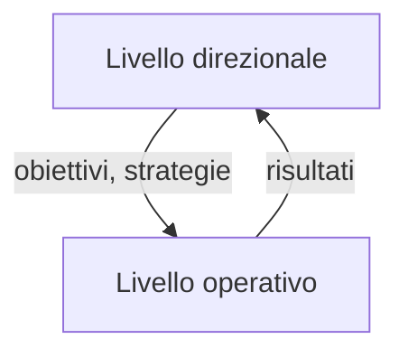
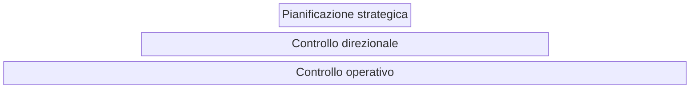
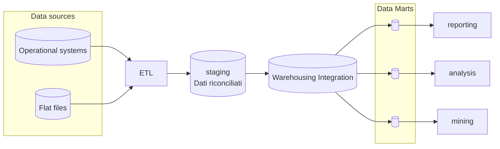
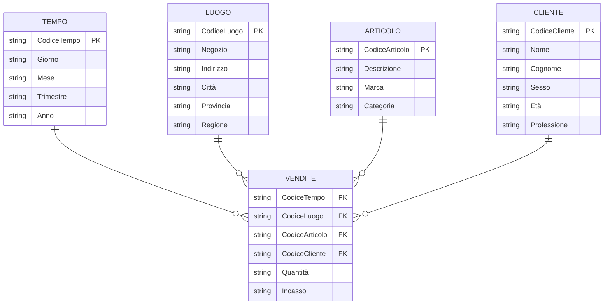
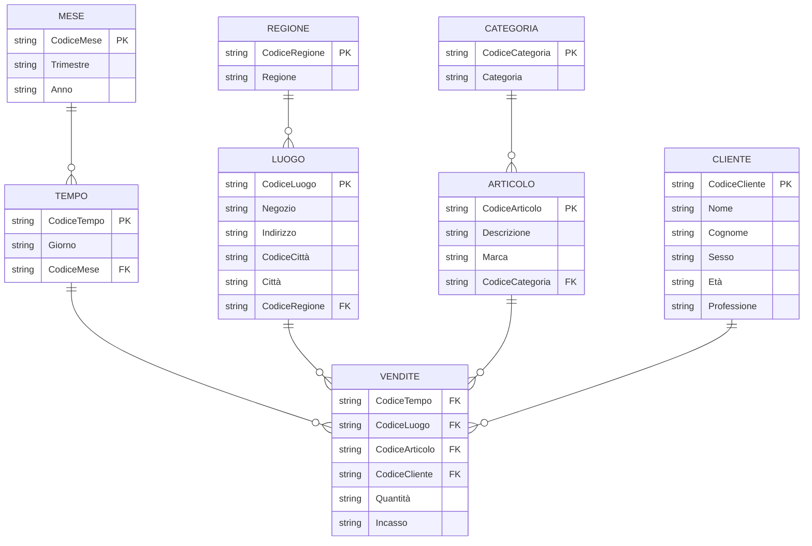

- **Livello direzionale**: si occupa delle attività necessarie alla definizione di obiettivi da raggiungere e alle strategie da intraprendere per perseguirli 
- **Livello operativo**: si occupa delle attività che l'azienda produce in maniera propria, fornendo al livello direzionale le informazioni sui risultati raggiunti

# Tipi di sistemi direzionali

- **Pianificazione strategica**: determina gli obiettivi generali dell'azienda
- **Controllo direzionale di gestione**: definisce traguardi economici, cioè risultati da conseguire a medio termine, e la loro verifica
- **Controllo operativo**: assicura che le attività dei processi aziendali procedano nel modo stabilito

I sistemi direzionali aggregano i dati per poterli fornire ai dirigenti aziendali in maniera sintetica, chiamate *Indicatori prestazionali*, come vendite, ricavi, etc

Le informazioni direzionali hanno diverse dimensioni:
- Dimensione **Tempo**
- Dimensione **Prodotto**: analisi di costi e ricavi 
- Dimensione **Processi**: analisi di indici di efficienza ed efficacia (es tempestività)
- Dimensione **Responsabilità**: Ad ogni centro sono associati alcuni indici che forniscono rendiconti sulle prestazioni dei singolo dirigenti
- Dimensione **Cliente**: analizza la redditività, volume di affari e bacino di utenza

# Data warehouse (DWH)

è una base di dati relazionale utile ai processi direzionali, centralizzata ad essere:
- Orientata ai soggetti dell'elaborazione
- Integrata
- Tempo - variante
- non volatile

## Orientata al soggetto

è una collezione di dati orientata ai soggetti dell'elaboraione, al contrario di un approccio processivo/funzionale dei database normali

## Integrata

Le informazioni dei processi operativi che alimentano il DWH possono provenire da diversi database, con caratteristiche e formati inconsistenti. I dati di un DWH devono essere integrati, convertendo in un formato comune al dwh

## Tempo - variante

Tutti i dati in un WDH si riferiscono ad un preciso arco temporale, ogni struttura in un DWH contiene un riferimento ad un valore temporale

## Non volatile

I dati in un DWH possono solo essere caricati e letti, non modificati o eliminati

# Sistemi  OLTAP (operativi) vs OLAP (direzionali)

| sistemi operativi                                  | sistemi direzionali                         |
| -------------------------------------------------- | ------------------------------------------- |
| Memorizzano dati correnti                          | Memorizano dati storici                     |
| Memorizzano dati dettagliati                       | Dati sono debolmente o fortemente aggregati |
| I dati sono dinamici                               | I dati sono statici                         |
| Le elaborazioni sono ripetitive                    | Elaborazioni ad hoc                         |
| Massimizza il throughput rispetto alle transazioni | Hanno un throughput di transazioni basso    |
| Sono transaction driven                            | Sono analysis driven                        |
| Orientati alle applicazioni                        | Orientati al soggetto                       |
| Supportano decisioni day to day (?)                | Supportano decisioni strategiche            |
| Grosso numero di utenti operativi                  | Basso numero di utenti manageriali          |

# Architettura di un DWH

## Data sources

Il DWH usa sorgenti di dati eterogenee provenienti da:
- **sistemi operazionali**: tipo relazionali.
- **Applicazioni legacy**: applicazioni aziendali ce non rispettano requisiti architetturali moderni
- **Sistemi informativi esterni**
- **Flat files**: dati non strutturate in tabelle relazionali

## ETL

I dati dalle varie sorgenti devono essere **ripuliti** eliminando possibili incongruente e inconsistente, **completati** da parti mancanti e **integrati** rispetto uno schema comune del DWH, tramite strumenti di **Extraction, Transformation and Loading** (ETL)

## Staging

Una volta essere stati integrati, corretti, filtrati e validati dall'ETL, i dati sono posti in un area di staging che contiene i dati **riconciliati**, che sono pronti ad alimentare il DWH

## Warehousing Integration

Le informazioni sono raccolte in un singolo contenitore logicamente centralizzato, ed è praticamente il DWH. Contiene anche i metadati che danno informazioni sui dati del DWH come sorgente di dati e le trasformazioni che hanno dovuto conseguire, informazioni sui profili delle query per migliorare le prestazioni e le informazioni sulla gestione dei dati come le tabelle, viste e indici

## Data marts

Memorizzano un insieme di dati nel DWH in forma molto aggregata, analizzano una particolare area di business o dipartimento, possono essere autonomi o collegati al DWH. Esso si preoccupa solo di uno specifico dipartimento e non contiene dati operativi. Un datamart può essere una vista di un DWH, esso permette un accesso alle informazioni più usate, migliorando i tempi di risposta.

# Acquisizione e gestione dati

## INFLOW
 
Con il termine inflow si indicano i processi associati all'estrazione, filtraggio e caricamenti dei dati da sorgenti OLTP al DWH

## Upflow

Con il termine Upflow si indicano i processi di aggiunta di dati al DWH tramite l'aggregazione. Queste operazioni pongono i risultati operazionali in varie forme, per esempio: dettagliati, parzialmente aggregati, fortemente aggregati etc. Tutto questo per agevolare la costruzione di diagrammi e grafici da parte degli utenti finali

## Downflow

Con il termine Downflow si intendono i processi di archiviazione sicura dei dati in un DWH, essi assicurano la ricorstruzione del DWH in caso di guasi o perdita di dati

## Outflow

Con il termine Outflow si intendono i processi che hanno il compito di rendere disponibili i dati all'utente finale, e quindi sono quelli che soddisfano le richieste degli utenti

## Metaflow

Con il termine Metaflow si intendono i processi associati alla gestione dei metadati

# Tecnologie di Data Warehousing

I dati integrati nella warehouse devono essere consultabili al fine di:
- **Query e reporting**: stendere report
- **OLAP**: (on line analytical processing), effettua analisi e simulazioni avanzate
- **KDD**: (Knowledge Discoveri in Database), individua regole nascoste nei dati

## Query e reporting

è il processo di
1) Porre un interrogazione
2) Trovare i dati fondamentali dal DWH
3) Trasformare i dati in un contesto appropriato
4) Prepare i dati in un formato leggibile
5) Spedire i dati in formato leggibile

## OLAP

L'analisi dei dati avviene in maniera multidimensionale analizzando 3 concetti fondamentali:
- **Fatto**: Un concetto dove viene concentrata l'analisi (es: vendita)
- **Misura**: Una proprietà atomica del fatto (es: incasso)
- **Dimensione**: Il punto di interesse dell'analizi (es: singolo articolo, luogo, tempo)
Ogni dimensione ha una gerarchia che rappresenta i possibili libelli di aggregazione dei dati, in base a:
- **Tempo**, es: giorno, mese, anno etc...
- **Luogo**, es: negozio, città, provincia, regione, etc...
- **Articolo**, es: descrizione, categoria, etc...

![[Pasted image 20230710131601.png]]

Ci sono due approcci all'implementazione di questa analisi multidimensionale:

- **Multidimensional OLAP (MOLAP)**: Se l'insieme dei dati è archiviato come matrice sparsa, dove sono registrati tutte le sintesi sui vari incroci multidimensionali possibili, il visualizzatore dei dati chiede direttamente i dati al database multidimensionale. Ha il vantaggio di essere precalcolato quindi l'accesso ai dati è molto veloce, ma deve essere aggiornato quando vengono fatte modifiche al database dal quale viene generato
- **Relational OLAP (ROLAP)**: Se l'insieme dei dati è registrato su una o più tabelle relazionali, i dati in questo caso sono acceduti tramite query e poi vengono sintetizzati per la visualizzazione dei risultati. Ha il beneficio di essere sempre aggiornato con gli ultimi dati disponibili, ma ogni volta che si accede ad una sintesi, si deve rieseguire l'estrazione e sommarizzazione

## MOLAP
Ha come perno il concetto di array multidimensionale, o ipercubo, cosi che i dati possano essere analizzati in tutte le dimensioni in maniera più facile. Ogni cella di dati contiene il valore assunto in ciascuna misura.

![[Pasted image 20230710132312.png]]

un MOLAP offre operazioni di:
- **Slide and dice**: Seleziona e proietta
- **Roll up**: Aggrega i dati (es: totale di vendite di un prodotto e regione)
- **Drill down**: Disaggrega i dati (es: per una categoria di prodotto e regione mostra le vendite giornaliere di ogni negozio)
- **Pivot**: Riorienta il cubo

## Esempio

![[Pasted image 20230710132536.png]]
**SLICE AND DICE** sulle vendite dei lettori dvd nei vari trimestri

| LETTORI DVD | 1 trim. 03 | 2 trim. 03 | 3 trim. 03 | 4 trim. 03 |
|---|---|---|---|---|
| Roma-1 | 38 | 91 | 66 | 198 |
| Roma-2 | 155 | 219 | 248 | 265 |
| Milano-1 | 121 | 273 | 266 | 326 |
| Milano-2 | 222 | 122 | 155 | 200 |

**ROLLUP** sulle città delle sedi per trovare i lettori dvd venduti in una sede

| LETTORI DVD | 1 trim. 03 | 2 trim. 03 | 3 trim. 03 | 4 trim. 03 |
|---|---|---|---|---|
| Roma | 193 | 310 | 314 | 463 |
| Milano | 343 | 395 | 421 | 526 |

**ROLLUP** vendite trimestrali sui prodotti

| VENDITE TRIM. | 1 trim. 03 | 2 trim. 03 | 3 trim. 03 | 4 trim. 03 |
|---|---|---|---|---|
| Lettori DVD | 536 | 705 | 735 | 989 |
| Televisori | 567 | 716 | 606 | 717 |
| Lettori CD | 187 | 155 | 186 | 226 |
| Videoregistratori | 175 | 191 | 202 | 319 |

**Drill down** per scoprire i mesi delle vendite mensili 

| VENDITE MENSILI | Gen 03 | Feb 03 | Mar 03 | Apr 03 | Mag 03 | Giu 03 | … |
|---|---|---|---|---|---|---|---|
| Lettori DVD | 165 | 178 | 193 | 205 | 244 | 256 | … |
| Televisori | 154 | 201 | 212 | 245 | 255 | 216 | … |
| Lettori CD | 54 | 88 | 45 | 24 | 65 | 66 | … |
| Videoregistratori | 56 | 64 | 55 | 52 | 64 | 75 | … |

## Knowledge Discover in database

Il processo di **KDD** è un processo interattivo e iterativo suddiviso in varie fasi:

1) **Identificazione del problema**: Si tiene conto della conoscenza già acquisita e gli obiettivi che si vogliono perseguire
2) **Selezione dell'insieme dei dati**: La fase di discovery dei dati, dove si estraggono i dati dalla conoscenza
3) **Pulizia e normalizzazione dei dati**: Per esempio si eliminano dati rumorosi e si gestiscono campi vuoti etc
4) **Identificazione caratteristiche salienti per rappresentare un fenomeno**: Si tende a ridurre il numero di variabili prese in considerazione in base all'analisi che stiamo facendo
5) **Data mining**: Si compie la ricerca sui pattern d'interesse
6) **Interpretazione dei pattern**: Si interpretano i dati trovati e potenzialmente si torna agli step precedenti per multiple iterazioni
7) **Consolidazione e formalizzazione**: Si crea documentazioni, presentazioni, etc... su ciò che si è scoperto

Durante il KDD si cerca di trovare pattern sconosciuti ma validi, cioè regole che si adattano bene ai dati che si stanno analizzando

# Modelli DWH, Schemi relazionali  stella

Uno schema a stella è composto da una tabella principale chiamata di *Tabella fatti* che memorizza i fatti e misure, e da due o più tabelle autisiali chiamate *Tabelle dimensione* che rappresenta una dimensione interessante dove analizzare i dati.

Nella tabella fatti la chiave primaria è formata da formata dai riferimenti delle altre tabelle dimensione, i dati sono considerati in sola lettura e gli altri campi non chiavi sono misure. è in 3NF

Nella tabella dimensioni la chiave primaria è semplice, gli altri campi memorizzano i livelli della dimensione ed è denormalizzata (pre joinata insieme), cioè contiene ridondanza, se è normalizzata allora si parla di schema a fiocco di neve, es:

Un fatto è di solito additivo, cioè ha senso sommarlo rispetto alla combinazione di altre dimensioni da cui dipende, per esempio l'incasso è additivo perchè ha senso calcolare la somma degli incassi di un certo intervallo

# Progettazione del DWH

- Si identificano i fatti, misure e dimensioni
- Si ristruttura lo schema concettuale per rappresentare i fatti mediante entità, si trovano eventuali nuove dimensioni e si raffinano i livelli di ogni dimensione
- Si deriva un grafo dimensionale
- Si deriva uno schema multidimensionale in uno logico 
- Si determina uno schema relazionale a stella
- 
