## Multiplexing e demultiplexing

Il Multiplexing in invio aggiunge metadati i pacchetti inviati, mentre il demultiplexing in ricezione utilizza questi metadati per indirizzare il pacchetto al socket appropriato:

![[Pasted image 20241102163653.png]]

Un segmento inviato tramite TCP/UDP contiene il numero porta sorgente e destinazione, l'IP di sorgente e destinazione, dei metadati e i dati veri e propri. l'host utilizzerà l'indirizzo IP e il numero di porta per decidere dove mandare il segmento.

## Trasporto in UDP

Il protocollo UDP permette ai segmenti di essere perduti/consegnati in una qualsiasi sequenza, anche non ordinata. Non ha bisogno di handshaking tra mittente e destinatario.
è usato nello streaming multimediale o realtime, e se necessario, è possibile aggiungere affidabilità e recupero degli errori nell'applicazione che utilizza UDP, dato che non è gestito dal protocollo stesso.

Ha il vantaggio di essere più veloce nell'invio dei dati, dato che non ha bisogno di instanziare una connessione, ha un intestazione del segmento più piccola, ed è in generale più semplice.

Una gestione dell'errore che viene implementata è però il checksum, UDP non garantisce che un pacchetto arrivi a destinazione, ma tramite il checksum, che è una sequenza di 16bit, permette al ricevente di confermare che i dati presenti nel segmento siano corretti.
Il calcolo del checksum viene effettuato tramite somma a complemento a 1 dei contenuti del segmento

## Trasferimento dati affidabile:

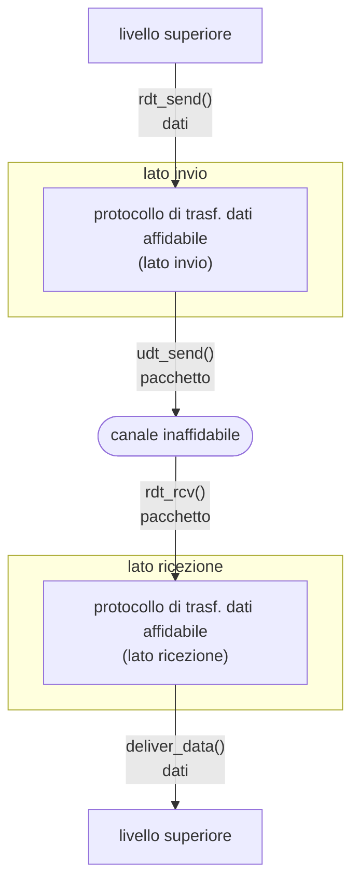

- `rdt_send()`: chiamata dall'alto, (ad es. dall'applicazione). Trasferisce i dati da consegnare al livello superiore del ricevente
- `deliver_data()`: chiamata da **rdt** per consegnare i dati al livello superiore
- `udt_send()`: chiamata da rdt per trasferire il pacchetto al ricevente tramite il canale inaffidabile
- `rdt_rcv()`: chiamata quando il pacchetto arriva nel lato ricezione del canale

In un ipotesi di implementazione del nostro algoritmo RDT (reliable data transfer) che ha un canale di comunicazione affidabile, il mittente invia i dati al canale di comunicazione e il ricevente legge i messaggi dal canale.

Se il canale sottostante può confondere dei bit (e quindi avere errori), abbiamo bisogno del checksum per sapere se il valore è corretto o meno. 
Utilizziamo gli ACK per confermare che un pacchetto è stato ricevuto senza errori, mentre un NAK per dire che abbiamo ricevuto un pacchetto con errori, permettendo al mittente di rinviare i pacchetti con errori.

**mittente**

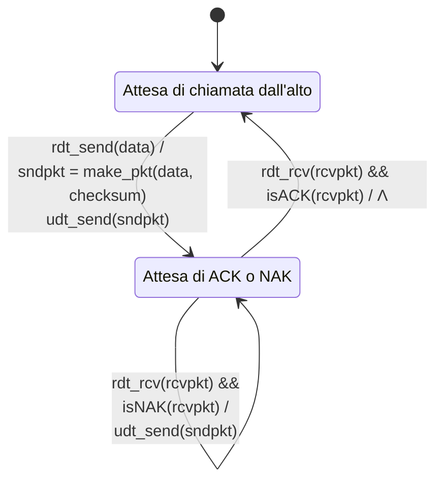

**ricevente**

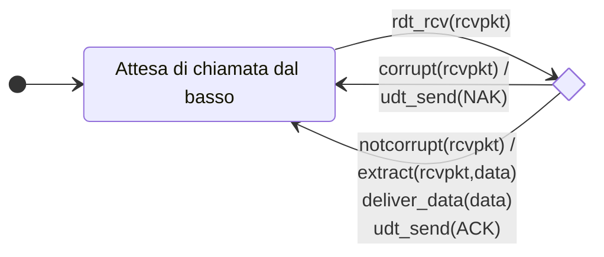

Ma gli ACK e NAK sono essi stessi pacchetti, cosa fare se essi sono danneggiati? Può ritrasmettere un pacchetto inviato aggiungendo un numero di sequenza, cosi da poter scartare eventuali pacchetti duplicati. 

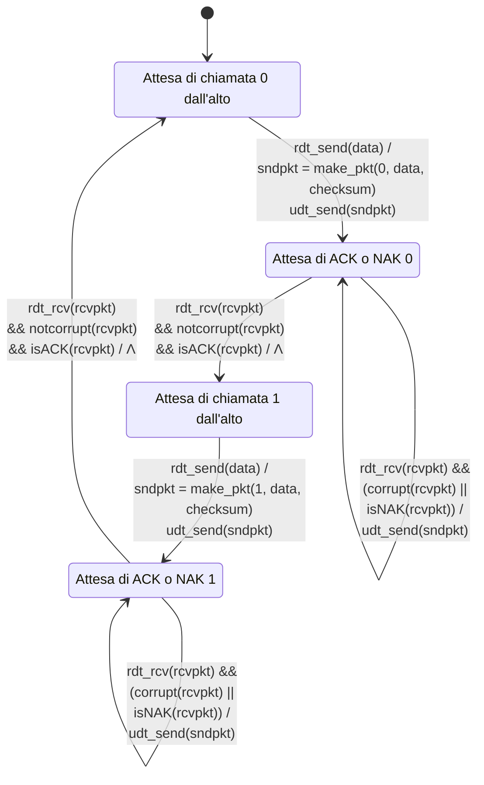

- **Il mittente** aggiunge un numero di sequenza al pacchetto, valore di 0 e 1 bastano dato che i pacchetti sono inviati con metodo di stop and wait, quindi semplicemente pacchetti con la stessa sequenza rispetto l'ultimo pacchetto sono scartati. 
- **Il ricevente**: controlla se il pacchetto ricevuto è duplicato tramite il numero di sequenza, ed in caso lo scarta. 

Un protocollo non ha bisogno dei NAK, si possono usare semplicemente gli ACK per specificare quali pacchetti sono stati ricevuti correttamente. Il destinatario invia un ACK con il numero di sequenza dell'ultimo pacchetto con l'ACK, che se è duplicato, determina che bisogna rinviare il pacchetto corrente.

Il canale può perdere il pacchetto di ACK dato che viene accordato che gli ACK devono essere ricevuti entro un tempo "ragionevole", il cui se superato può indicare il mancato ricevimento di un ACK, e quindi pensando al pacchetto come perso, verrà inviato un altra volta duplicato.

**(a) nessuna perdita**

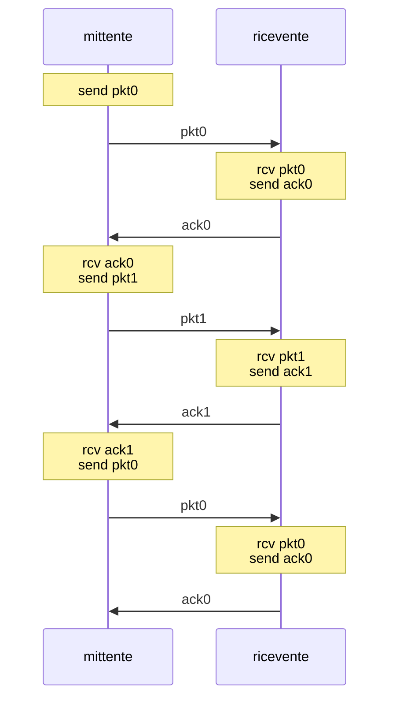

**(b) perdita di pacchetto**

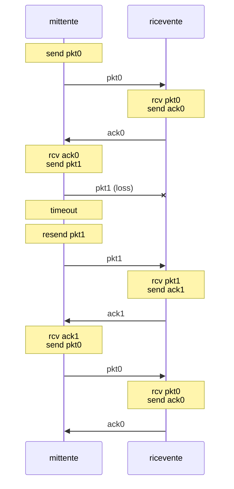

**(c) perdita di ACK**

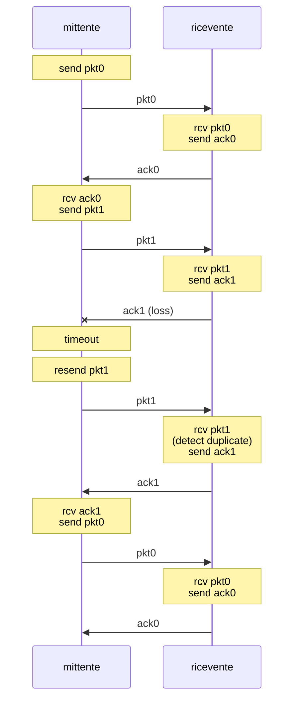

**(d) timeout prematuro per ACK in ritardo**

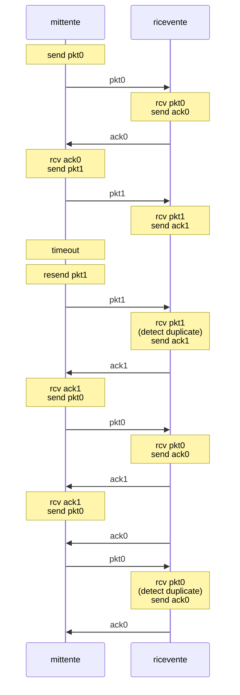

La tecnica stop and wait ha una latenza molto alta dato che si deve aspettare 2 RTT per ogni pacchetto inviato. Per questo si usano protocolli con pipeline, dove il mittente ammette che ci siano più di un pacchetto in transito. Si usano due forme di protocolli con pipeline, **go Back N** e **ripetizione selettiva**

- Go back N: il mittente può avere fino a N pacchetti consecutivi non riscontrati nella pipeline, il ricevente invia solo ACK cumulativi, e quindi non riscontra un pacchetto se c'è un buco (esempio se 5 6 8 sono arrivati, il pacchetto 8 non è riscontrato finchè 7 non arriva). Il mittente fa partire un timer, e se entro quel tempo non sono stati riscontrati tutti i pacchetti, essi vengono rinviati 
- **Ripetizione selettiva**: Il mittente può avere fino ad N pacchetti consecutivi non riscontrati in pipeline ed il ricevente invia un ACK per ogni pacchetto. Il mittente ha un timer per ogni pacchetto non riscontrato, se esso scade, il pacchetto viene rinviato 

# TCP

è un protocollo di comunicazione con garanzia dei dati. 
Ha controllo di congestione e flusso, i dati possono essere inviati sia dal ricevente che dal mittente in maniera full duplex, è orientato alla connessione (tramite handshaking), e il mittente non sovraccarica il destinatario.

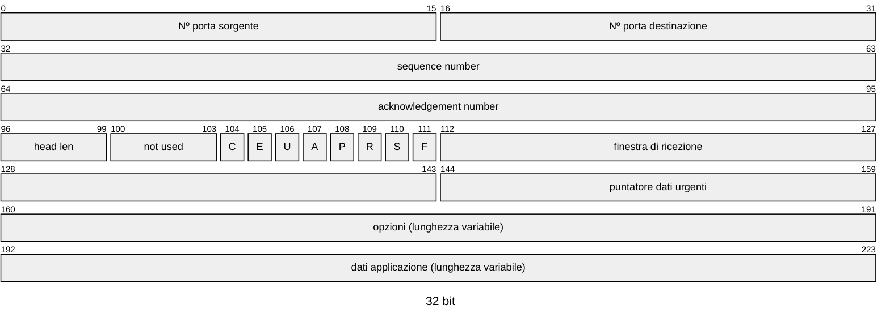

- **numero di riscontro**: numero di sequenza del prossimo byte atteso; A bit: numero di riscontro valido
- **numero di sequenza**: conteggio dei byte nel flusso di dati (non dei segmenti!)
- **lunghezza** (dell'header TCP)
- **C, E**: notifica di congestione
- **opzioni TCP**
- **RST, SYN, FIN**: gestione della connessione
- **controllo di flusso**: numero di byte che il destinatario vuole accettare
- **dati** inviati dall'applicazione nella socket TCP

Il valore del timeout per i pacchetti deve essere di sicuro più alto del RTT, che viene stimato tramite il tempo speso in media dai pacchetti per essere inviati e ricevere ACK. Con un valore troppo piccolo di timeout si andrebbe a ritrasmettere pacchetti inutilmente, mentre un valore troppo alto rallenterebbe la velocità di trasmissione

Il numero di sequenza è il numero del primo byte del segmento del flusso di byte, una volta che un ACK è ricevuto.

**scenario con ACK perso**

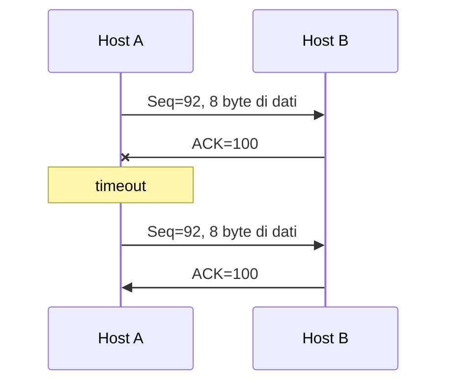

**timeout prematuro**

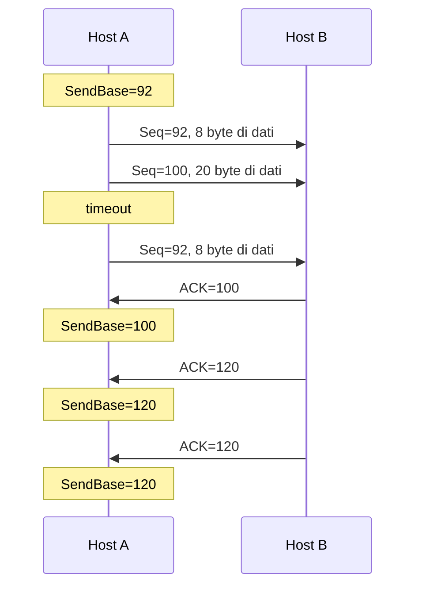

| evento nel destinatario | azione del ricevente TCP |
|---|---|
| arrivo ordinato di un segmento con numero di sequenza atteso. Tutti i dati fino al numero di sequenza atteso sono già stati riscontrati | ACK ritardato. Attende fino a 500 ms l'arrivo del prossimo segmento. Se il segmento non arriva, invia un ACK |
| arrivo ordinato di un segmento con numero di sequenza atteso. Per un altro segmento è stato inviato l'ACK ma non ancora riscontrato | invia immediatamente un singolo ACK cumulativo, riscontrando entrambi i segmenti ordinati |
| arrivo non ordinato di un segmento con numero di sequenza superiore a quello atteso. Viene rilevato un buco | invia immediatamente un *ACK duplicato*, indicando il numero di sequenza del prossimo byte atteso |
| arrivo di un segmento che colma parzialmente o completamente il buco | invia immediatamente un ACK, ammesso che il segmento cominci all'estremità inferiore del buco |

### Controllo di flusso in TCP

Il destinatario modera il mittente rispetto a quanti pacchetti riesce ad elaborare, in maniera tale da non sovraccaricare il buffer, e permettere a meno pacchetti di essere persi. 
Il destinatario invia al mittente quanto spazio libero del buffer ha, cosi che il mittente limiti la quantità di pacchetti unacked, garantendo che il buffer non vada in overflow.

### Gestione della connessione

Prima di scambiarsi dati, il sender e il receiver effettuano un handshake per accordarsi che entrambi vogliano stabilire la connessione, e condividono vari parametri della connessione, come per esempio la grandezza del buffer del destinatario, etc...
L'handshake è effettuato in 3 roundtrips:

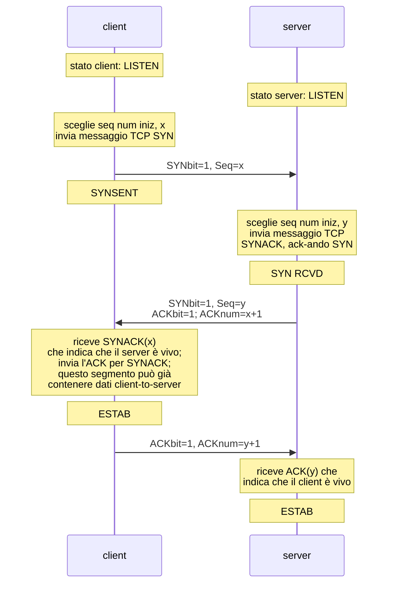

Mentre per terminare una connessione, inviano un pacchetto TCP con flag FIN ad 1, ed una volta ricevuto un ACK, la connessione può essere considerata terminata

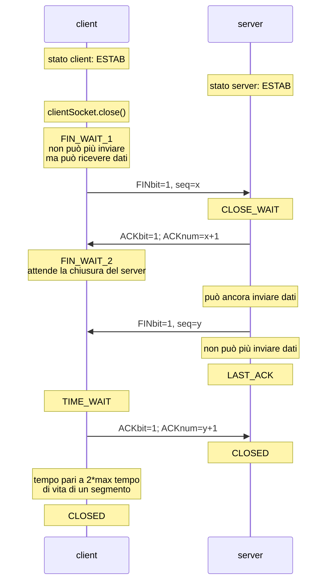

### Controllo di congestione in TCP

Per gestire la congestione, si deve trovare un throughput tale da non scartare alcun pacchetto per colpa di buffer pieni. Si usa una tecnica chiamata **AIMD**, **Additive Increase** incrementa il rate di invio di 1 messaggio per RTT finchè non ci sono perdite. Una volta che si trovano perdite, si riduce di metà il rate di invio. 

Questo ha il lato negativo di avere una partenza di connessione lenta, dato che si deve partire da 1 messaggio inviato, per poi crescere fino a trovare il throughput massimo. Per mitigare ciò, anzichè inviare solo un pacchetto per round trip, nella fase iniziale viene raddoppiato il numero di pacchetti inviati per ogni Round trip, cosi da poter trovare più velocemente il valore massimo di throughput della connessione.

In alternativa alla crescita lineare, possiamo usare il metodo Cubic dove ogni volta che si dimezza, si incrementa esponenzialmente all'inizio, per poi crescere più lentamente man mano che ci si avvicina al precedente valore massimo

```plot
x: [-0.7, 4.9]
y: [0, 1.35]
width: 520
height: 280
xlabel: time
ylabel: TCP sending rate
xticks: { 0: "$t_0$", 1: "$t_1$", 2: "$t_2$", 3: "$t_3$", 4: "$t_4$" }
yticks: { 1: "$W_{max}$" }
items:
  - line: [[-0.05, 1], [4.9, 1]]
    dash: true
    color: muted
  - fn: g(x) = exp(8x)
    domain: [-0.6, 0]
    color: muted
    width: 3
  - line: [[0, 0.5], [1, 1]]
    color: red
  - line: [[1, 0.5], [2, 1]]
    color: red
  - line: [[2, 0.5], [3, 1]]
    color: red
  - line: [[3, 0.5], [4.9, 1.45]]
    color: red
  - fn: c0(x) = 1 + 0.5 (x - 1)^3
    domain: [0, 1]
    color: blue
    dash: true
  - fn: c1(x) = 1 + 0.5 (x - 2)^3
    domain: [1, 2]
    color: blue
    dash: true
  - fn: c2(x) = 1 + 0.5 (x - 3)^3
    domain: [2, 3]
    color: blue
    dash: true
  - fn: c3(x) = 1 + 0.5 (x - 4)^3
    domain: [3, 4.9]
    color: blue
    dash: true
  - text: TCP Reno
    at: [3.9, 0.35]
    color: red
  - text: TCP CUBIC
    at: [3.9, 0.22]
    color: blue
```

 ### Explicit Congestion Notification (ECN)
 TCP spesso implementano un controllo di congestione assistito alla rete, dove 2 bit dell'header IP sono marcati dal router per indicare il livello di congestione. La destinazione, se congestionata, setta i bit ECE nel segmento ACK per notificare della congestione.
 ![[Pasted image 20241102230809.png]]

### QUIC

è un protocollo che usa UDP insieme al controllo degli errori a livello di applicazione per poter inviare pacchetti senza perdite. 
Inoltre ha bisogno di soli 2 RTT per stabilire una connessione sicura, in confronto ai 4 RTT necessari per il TCP.
