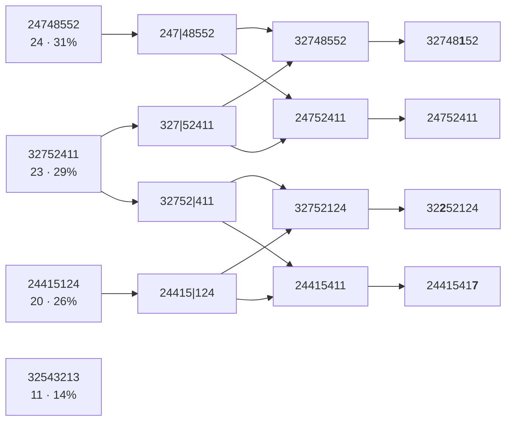

Gli algoritmi di ricerca locale operano dallo stato iniziale, senza tenere traccia degli stati o percorsi che sono stati raggiunti. 

Vuol dire che gli algoritmi di ricerca locale potrebbero non esplorare mai una porzione dello spazio che ha la soluzione, che li rende molto differenti dagli algoritmi precedentemente visti. Gli algoritmi che abbiamo visto sono chiamati "sistematici", cioè che è sempre possibile raggiungere un qualsiasi stato che è connesso tramite un percorso, allo stato iniziale.

Gli algoritmi di ricerca locale sono non sistematici. Non sono completi, ne ottimali, ma utilizzano pochissima meoria e possono comunque trovare soluzioni "accettabili" in spazi grandi o infiniti, che non sono facilmente eseguibili tramite algoritmi sistematici.

Lo scopo degli algoritmi di ricerca locale è di massimizzare una funzione obiettivo, ignorando gli stati goal da raggiungere, in questo modo si riesce a trovare il miglior stato rispetto la funzione obiettivo.

## Hill climbing
L'algoritmo di **hill climbing** tiene traccia dello stato corrente e ad ogni iterazione, si muove nel prossimo stato che ha il più alto valore della funzione obiettivo:

- Si dirige verso la direzione che ha la salita più rapida 
- l'ideale finale sarebbe quello di trovare il massimo globale, ma tipicamente riesce a trovare solo un massimo locale
- l'algoritmo termina quando raggiunge un "picco", dove nessuno stato vicino ha un valore maggiore della funzione obiettivo. Questo vuol dire che se una curva ha due picchi, il secondo più alto del primo, l'algoritmo si fermerà al primo picco.

```plot
x: [0, 40]
y: [-4, 27]
width: 560
height: 320
xlabel: state space
ylabel: objective function
items:
  - fn: f
    through: [[1, 3.5], [4.5, 5.5], [6.8, 8.5], [8, 12.5], [10.2, 12.5], [12.3, 22.7], [14.5, 12.5], [16, 5], [20.3, 1.7], [24, 11.5], [27.2, 3.3], [29.2, 7.6], [31.5, 7.6], [35, 2.7], [37.5, 1.9]]
    color: teal
    width: 2
  - text: global maximum
    at: [21, 24.5]
  - line: [[16.5, 24], [13.2, 22.8]]
  - text: shoulder
    at: [4.8, 17]
  - line: [[7, 15.8], [8.3, 13.3]]
  - text: local maximum
    at: [34, 14]
  - line: [[29.5, 13.2], [24.7, 11.8]]
  - text: '"flat" local maximum'
    at: [36.5, 11]
  - line: [[33.5, 10.2], [31.5, 8.2]]
  - line: [[21.7, -1.5], [21.7, 4.2]]
    arrow: true
  - line: [[21.9, 5.3], [22.5, 8.2]]
    arrow: true
  - point: [21.7, 4.7]
    color: muted
  - text: current
    at: [21.7, -2.8]
  - text: state
    at: [21.7, -4.2]
```

Per aumentare la possibilità di trovare il massimo locale:

- permettiamo movimenti "laterali", cioè di muoversi tra stati che hanno lo stesso valore della funzione obiettivo (shoulders)
- **Stochastic hill climbing**: è una variante che, anzichè scegliere lo stato vicino con il valore della funzione obiettivo più alta, sceglie randomicamente uno stato tra quelli vicini con valore più alti 
- **First choice hill climbing**: come lo stochastic hill climbing, ma continua generare stati successivi finchè non ne trova uno che è migliore rispetto al corrente
- **Random restart**, esegue una serie di hill-climbing da uno stato iniziale randomico, scegliendo poi la soluzione ottima tra queste

Tutti gli algoritmi di hill climbing trovano il massimo locale, massimizzando il valore di una funzione. 
Se vogliamo trovare il *minimo* locale, ci basta invertire il segno della funzione obiettivo 

## Simulated annealing

Il simulated annealing è un algoritmo di ricerca locale che cerca di limitare la possibilità di essere bloccati in uno stato di massimo locale, permettendo di muoversi in stati di valore minore.

Il nome è dato dal processo di "annealing" nella metallurgia dove per aumentare la durezza di un metallo, lo si riscalda ad alte temperature per poi raffreddarlo lentamente.

Nel contesto dell'ottimizzazione della funzione obiettivo, partiamo da uno stato iniziale randomico, scegliendo un valore di "temperatura". A questo punto iteriamo fino ad una condizione terminale, ed ad ogni iterazione, in base al valore della temperatura, possiamo scegliere o meno se accettare un nuovo stato con valore della funzione obiettivo minore rispetto a quello corrente. 
Ad ogni iterazione diminuiamo il valore di temperatura, causando la diminuzione di probabilità che uno stato peggiore venga scelto. 

La struttura generale è simile ad hill climbing, ma anzichè scegliere la migliore mossa, sceglie una mossa randomica.

Se questa mossa è migliore di quella corrente, essa viene sempre accettata.
Se la soluzione è peggiore, allora l'algoritmo accetta la soluzione con una probablità minore di 1.

La probabilità di accettare un nuovo stato diminuisce esponenzialmente in base a quanto "peggiore" sia la mossa, cioè dal suo $\Delta E$ (differenza dei due stati). 

La probabilità diminuisce anche quando il valore della temperatura diminuisce. Mosse che possono essere viste come "peggiori" sono favorite all'inizio quando il valore di temperatura $T$ è alto, e diminuisce man mano nelle iterazioni

```text
function SIMULATED-ANNEALING(problem, schedule) returns a solution state
  current ← problem.INITIAL
  for t = 1 to ∞ do
    T ← schedule(t)
    if T = 0 then return current
    next ← a randomly selected successor of current
    ΔE ← VALUE(next) − VALUE(current)
    if ΔE > 0 then current ← next
    else current ← next only with probability e^(ΔE/T)
```

## Local beam search

Tiene traccia di $k$ stati anzichè uno solo, partendo da $k$ stati scelti randomicamente
Ad ogni passo, i successori di tutti i $k$ sono generati, se uno di questi è il goal, allora si ferma. Se nessuno di loro è il goal, seleziona il migliore $k$ di questi e ripeti 

Una variante è il **Stochastic beam search** che sceglie i migliori $k$ successori, li sceglie con una probabilità in base alla funzione obiettivo

## Algoritmi evoluzionari 

Sono varianti degli algoritmi **stochastic beam search** che seguono il concetto di "selezione naturale". 

C'è una popolazione di individui (gli stati) dove i più forti (valore funzione obiettivo più alto) si "riproducono" generando altri individui (i prossimi stati) tramite un processo di "ricombinazione"

Ogni individuo ha una "stringa" che rappresenta il proprio "dna" e durante il processo di ricombinazione°



## Ricerca locale in spazi continui

Gli ambienti dove le azioni sono locati su spazi continui, cioè dove le variabili di uno stato possono assumere valori in un intervallo continuo (per esempio tutti i numeri tra 0 e 1). Questo causa la creazione di infiniti fattori di branching.

Un metodo per approssimare la soluzione a questo problema è di discretizzare l'intervallo selezionando un numero fisso di "sezioni" di questo intervallo, come per esempio `[0, 0.2] [0.2, 0.4] [0.4, 0.6]`...

Oppure di risolvere il problema in maniera analitica anzichè empirica, tramite l'uso di gradienti. 
