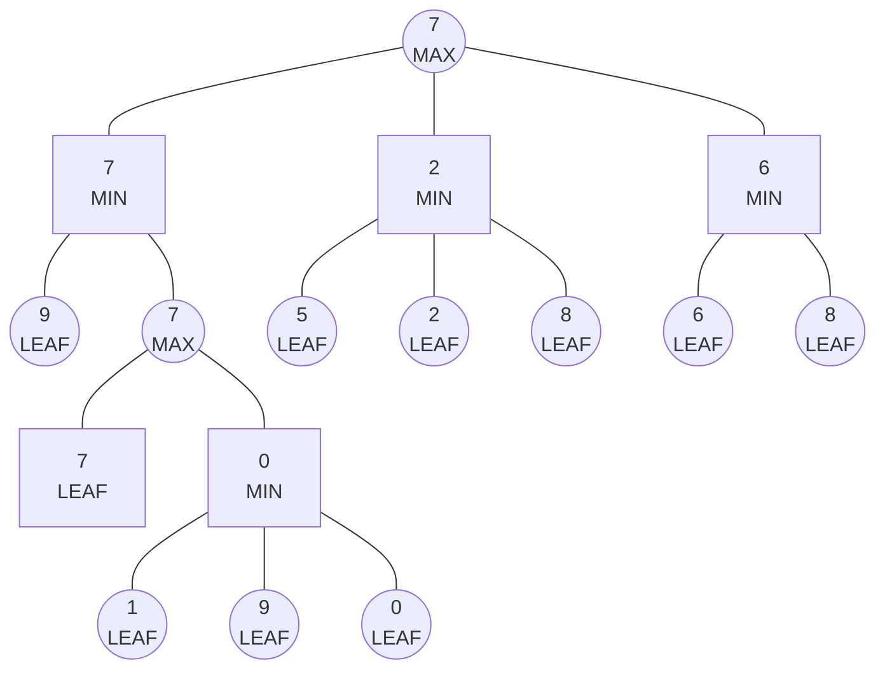
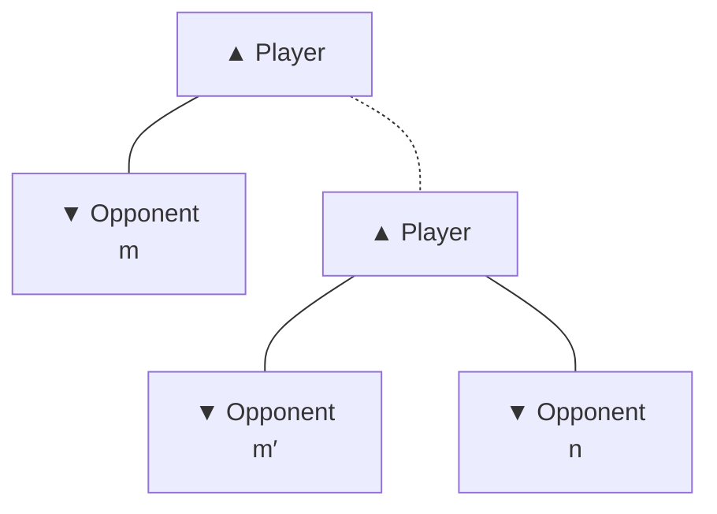
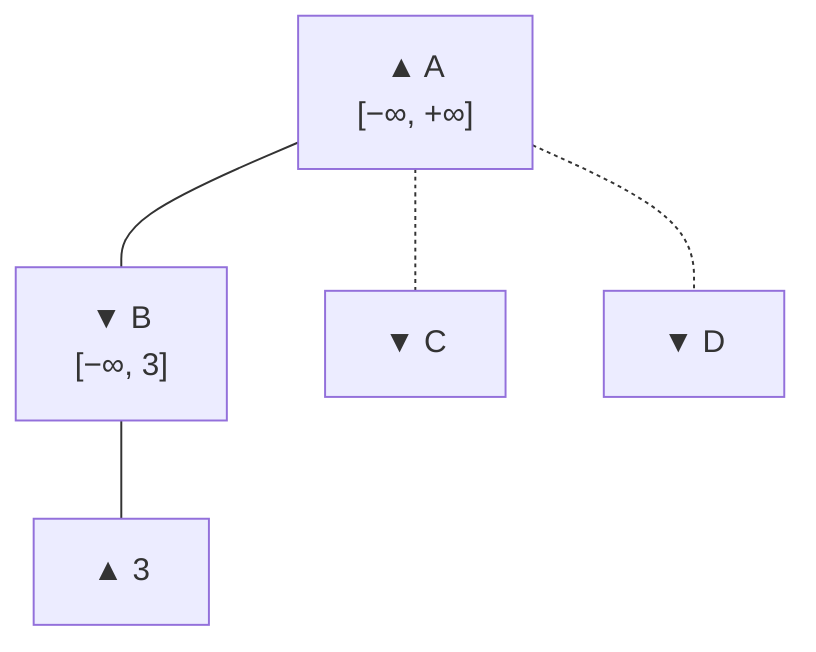
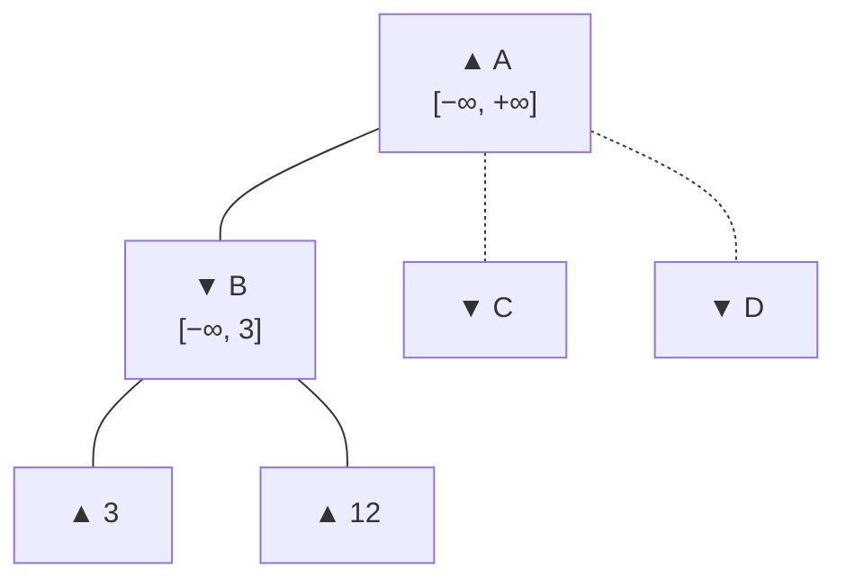
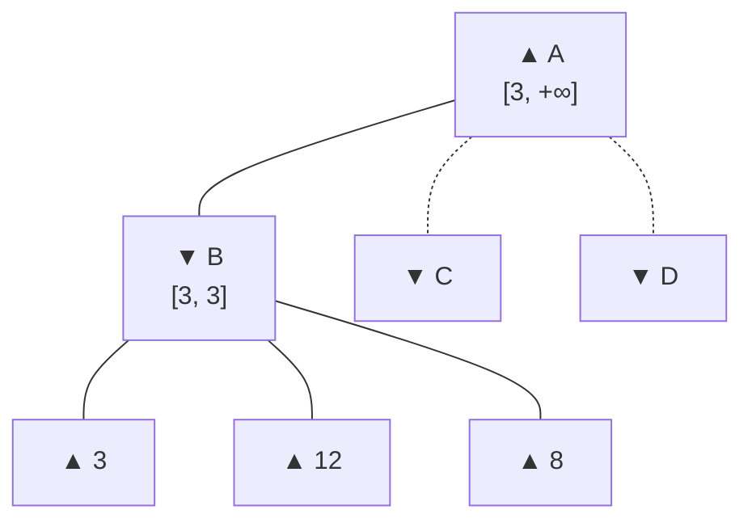
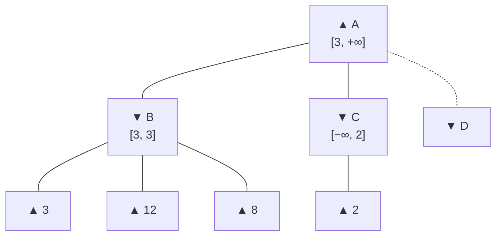
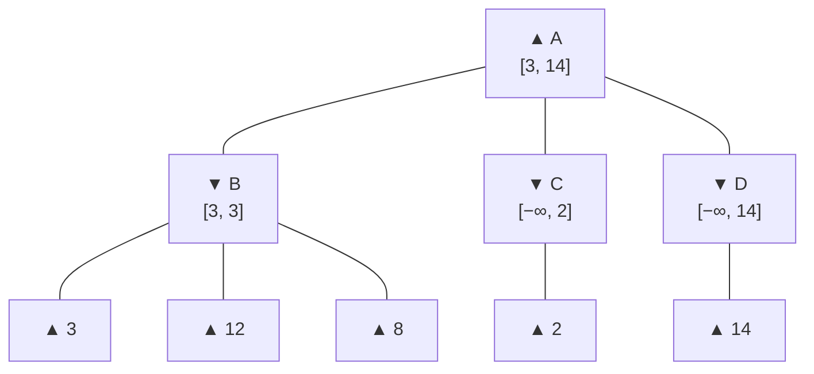
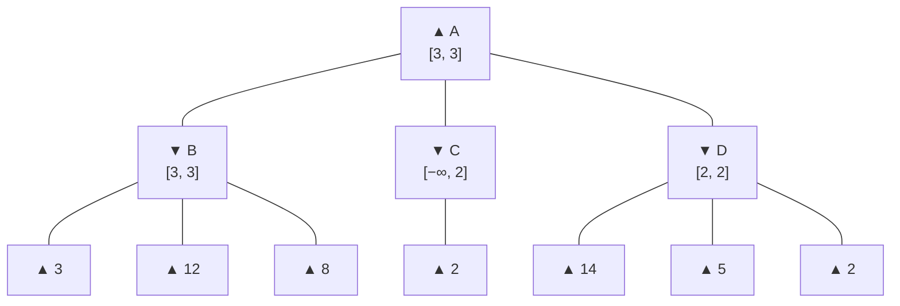

Molti problemi nella realtà non sono modellati tramite un singolo agente, ma con più agenti che interagiscono insieme nello stesso ambiente.

La scelta che fa uno degli agenti influenza le azioni di tutti gli agenti. Per questo motivo, un agente deve tenere in conto gli effetti delle azioni degli altri agenti prima di effettuare la propria.

Dato che le azioni degli altri agenti non possono essere sempre predette, l'ambiente è considerato parzialmente osservabile e con knowledge parziale

## Tipi di agenti

Agenti in un ambiente condiviso possono essere del tipo:
- Pienamente cooperativi, cioè comunicano tra di loro e ottimizzano un obiettivo globale condiviso. Può essere visto come un team, come il calcio.
- Pienamente competitivi (o avversari), gli agenti hanno scopi confliggenti, cioè che un agente raggiunge il proprio scopo se un altro agente non raggiunge il proprio. Per esempio, giochi dove solo uno dei due lati vince, come gli scacchi.

# Giochi
Un "gioco" può essere classificato tramite vari assi:
- è deterministico o stocastico? (per esempio scacchi è deterministico, mentre poker è stocastico)
- uno, due o più giocatori?
- competitivo o collaborativo?
- Completamente o parzialmente osservabile? 

una "mossa" è un azione effettuata da un agente mentre la "posizione" è lo stato in cui l'agente si trova

# Giochi Zero sum

La maggiorparte dei problemi studiati in AI sono giochi deterministici, con due giocatori, a turni, completamente osservabile e "zero sum", che da ora in poi chiameremo "giochi zero-sum"

Zero sum vuol dire che in un gioco completamente competitivo, un azione positiva per un agente, ha una reazione negativa nell'altro agente, la cui somma è 0. 

Quindi in un gioco zero-sum, i valori obiettivo dei due agenti sono l'opposto dell'altro. Quindi dobbiamo voler massimizzare l'obiettivo di un agente, minimizzando l'altro.

Formalizziamo un gioco zero-sum in questo modo:
- **Spazio di ricerca**, è un set di possibili stati in cui il gioco può far parte
- **Stato iniziale**, è lo stato usato all'inizio del gioco. Per semplicità assumiamo che il primo giocatore MAX inizi il gioco, giocando a turni con MIN fino alla fine
- **Test terminale**, per ogni stato $s$, ritnorna $true$ se il gioco è terminato, altrimenti $false$. Questi sono anche chiamati stati terminali
- **Azioni**, per ogni stato $s$, il set di mosse legali in $s$ 
- **Modello di transizione**, per ogni stato $s$ ed azione $a$, lo stato risultante applicando $a$ ad $s$
- **Funzione obiettivo**, per ogni giocatore $p$ e stati terminali $s$, definisce il valore finale del giocatore $p$ quando lo stato finisce in $s$. Per esempio in scacchi, vittoria, sconfitta e patta sono 1, 0 e 1/2 

Come un problema generale, lo stato iniziale, azioni e transizioni definiscono un grafo dello spazio degli stati.

Un algoritmo di ricerca può essere eseguito sopra questo grafo che definisce una serie di mosse.
Definiamo come albero completo del gioco, l'albero di ricerca di tutte le sequenze di mosse che portano allo stato terminale.

# Ricerca Min Max

Nei giochi zero-sum, i giocatori MAX e MIN hanno obiettivi contrastanti. Entrambi vogliono trovare una serie di azioni che li porteranno alla vittoria, causando quindi l'altro giocatore a perdere.

La strategia di MAX (e analogamente di MIN) è quella di trovare una strategia che riesce a "rispondere" ad ogni possibile mossa di MIN

Per giochi che hanno un risultato binario (vittoria o sconfitta), possiamo usare un albero AND-OR per generare un piano condizionale che risponde (appunto condizionalmente) ad ogni mossa dell'avversario.
Ma per giochi con più punteggi finali, usiamo la ricerca min-max.

Dato l'albero del gioco, lo scopo è quello di trovare una strategia ottimale di MAX, dove si assume che faccia la prima mossa. 

La strategia ottimale per MAX può essere trovata scoprendo il valore minmax di ogni stato $s$ nell'albero, che chiamiamo $MINIMAX(s)$ che, assumendo che entrambi i giocatori giochino per massimizzare il proprio obiettivo, è uguale al valore della funzione obiettivo nello stato $s$.

Una volta aver calcolato questo valore per ogni stato, la strategia è quella di trovare, ad ogni passaggio, la mossa che ci porta allo stato con il massimo valore minmax

```python
def value(state):
    if the state is terminal: return the state's utility
    if the next agent is MAX: return max-value(state)
    if the next agent is MIN: return min-value(state)
```

```python
def max-value(state):
    initialize v = -∞
    for each successor of state:
        v = max(v, value(successor))
    return v
```

```python
def min-value(state):
    initialize v = +∞
    for each successor of state:
        v = min(v, value(successor))
    return v
```



Questo algoritmo può essere implementato ricorsivamente, visitando fino alle foglie per poi risalire quando la ricorsione viene srotolata.
Complessivamente, l'algoritmo minmax effettua una ricerca completa DFS dell'albero del gioco 

Questo algoritmo ha complessità temporale $O(b^m)$ dato che deve poter esplorare l'intero albero. Ed una complessità spaziale di $O(b \times m)$ (oppure $O(m)$ tramite backtracking).
Il che rende questo algoritmo non utilizzabile per giochi "complessi" come gli scacchi, che avendo $m = 80$ e $b = 35$ ha all'incirca $35^{80} > 10^{123}$ 

La definizione di mossa ottimale di MAX per l'algoritmo minmax assume che MIN faccia anche esso una mossa ottimale. Ma se MIN non facesse la mossa ottimale? Allora vuol dire che MAX potrebbe fare una mossa ancora migliore rispetto quelle che aveva considerato.

Però questa scelta potrebbe non essere quella migliore. Consideriamo il caso in cui la mossa ottimale da entrambe le parti porti ad una patta, ma c'è una mossa "rischiosa" che MAX può fare che lo portrebbe portare alla vittoria 9/10 volte, e sconfitta 1/10 volte. Se MAX crede che MIN non riesca a calcolare la propria mosse ottimale, potrebbe provare ad effettuare la mossa rischiosa.
# Alpha beta pruning

Il numero di stati in un gioco è esponenziale in base alla profondità dell'albero. 

Nessun algoritmo è capace di eliminare completamente l'esponente, ma è possibile ridurre l'esponente a metà, facendo la scelta corretta minmax senza esaminare tutti gli stati, tagliando grandi parti dell'albero di ricerca che non contribuiscono al risultato.



Considera un nodo $n$ nel grafo dove il giocatore ha la scelta di fare una mossa per arrivare a $n$. 
Se il giocatore può fare una scelta migliore di $n$, o tra il livello corrente (quello dove si trova $n$, per esempio $m'$) oppure in qualsiasi altro punto nei livelli superiori dove ha il proprio turno (per esempio $m$), allora il giocatore non si muoverà mai su $n$, dato che le altre mosse sono migliori. 
Una volta che abbiamo raccolto abbastanza informazioni su $n$ per arrivare a questa conclusione, possiamo tagliare il sottoalbero di $n$.

Esempio:

**(a)**



The first leaf below *B* has the value 3. Hence, *B*, which is a MIN node, has a value of at most 3.

**(b)**



The second leaf below *B* has a value of 12; MIN would avoid this move, so the value of *B* is still at most 3.

**(c)**



The third leaf below *B* has a value of 8; we have seen all *B*'s successor states, so the value of *B* is exactly 3. Now we can infer that the value of the root is at least 3, because MAX has a choice worth 3 at the root.

**(d)**



The first leaf below *C* has the value 2. Hence, *C*, which is a MIN node, has a value of at most 2. But we know that *B* is worth 3, so MAX would never choose *C*. Therefore, there is no point in looking at the other successor states of *C*. *This is an example of alpha–beta pruning.*

**(e)**



The first leaf below *D* has the value 14, so *D* is worth at most 14. This is still higher than MAX's best alternative (i.e., 3), so we need to keep exploring *D*'s successor states. Notice also that we now have bounds on all of the successors of the root, so the root's value is also at most 14.

**(f)**



The second successor of *D* is worth 5, so again we need to keep exploring. The third successor is worth 2, so now *D* is worth exactly 2. MAX's decision at the root is to move to *B*, giving a value of 3.

- Here we can observe that *the effectiveness of alpha-beta pruning is (highly) dependent on the order* in which the states are examined: we could not prune any successors of *D* at all because the worst successors (from the point of view of MIN) were generated first.
- If the third successor of *D* had been generated first, with value 2, we would have been able to prune the other two successors.
- This suggests that it might be worthwhile to try to first examine the successors that are likely to be best.

Il nome alpha-beta viene dal fatto che per ogni nodo dobbiamo tenere traccia di due valori, appunto alpha e beta, che ci dicono 
- $\alpha$ il valore della miglior mossa che abbiamo trovato fino ad ora nel cammino di MAX
- $\beta$ il valore della miglior mossa che abbiamo trovato fino ad ora nel cammino di MIN

Questo algoritmo ha una complessità temporale di $O(b^{m/2})$ se scegliamo ogni volta la miglior mossa. 
Usando l'orinamento random move, il numero di nodi esaminati sarà invece $O(b^{3m/4})$. 
Naturalmente non possiamo sapere la mossa perfetta, altrimenti useremo questa scelta per giocare il gioco perfetto, ma possiamo andarci vicino tramite euristiche.

# Alberi di ricerca Monte Carlo

L'agoritmo "Monte Carlo Tree Search" (MCTS) è un alternativa ad alpha-search che rimpiazza la funzione euristica ed invece calcola il valore di uno stato tramite la media del valore obiettivo di un numero di simulazioni di giochi completi, partendo dallo stato iniziale.
