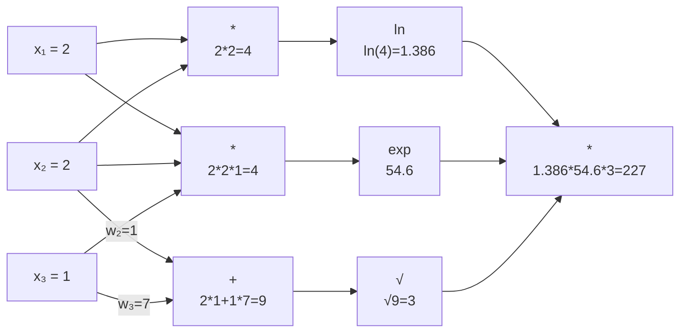
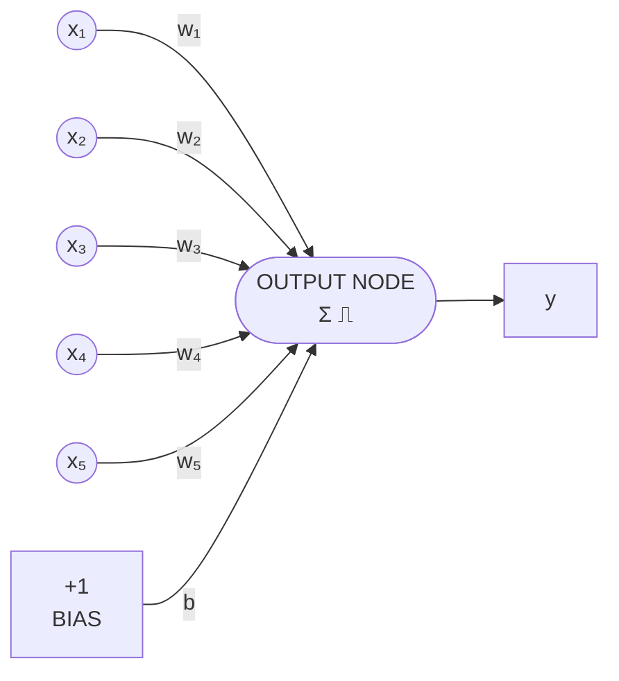
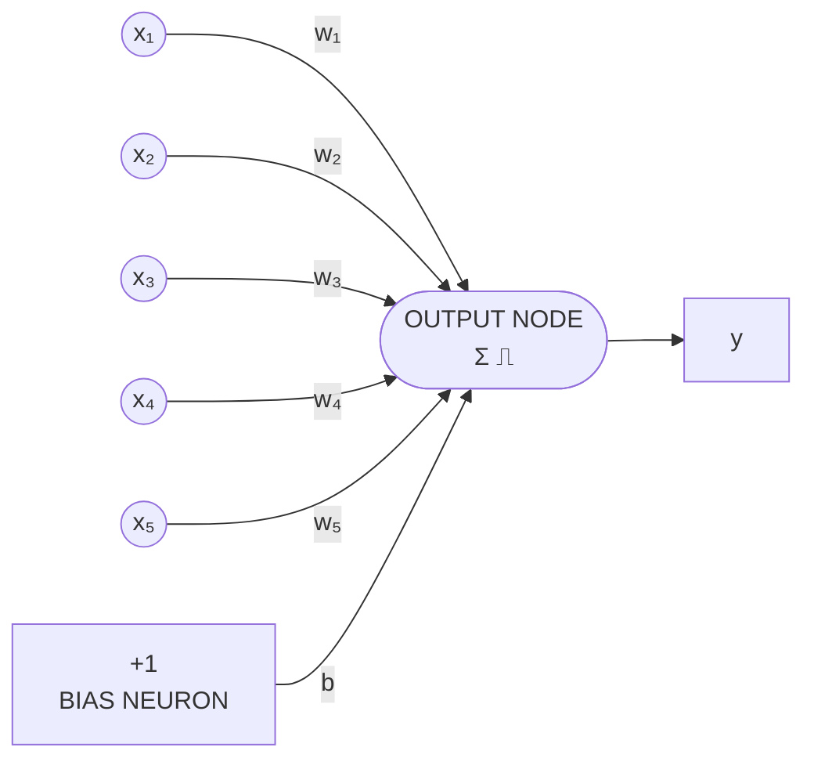
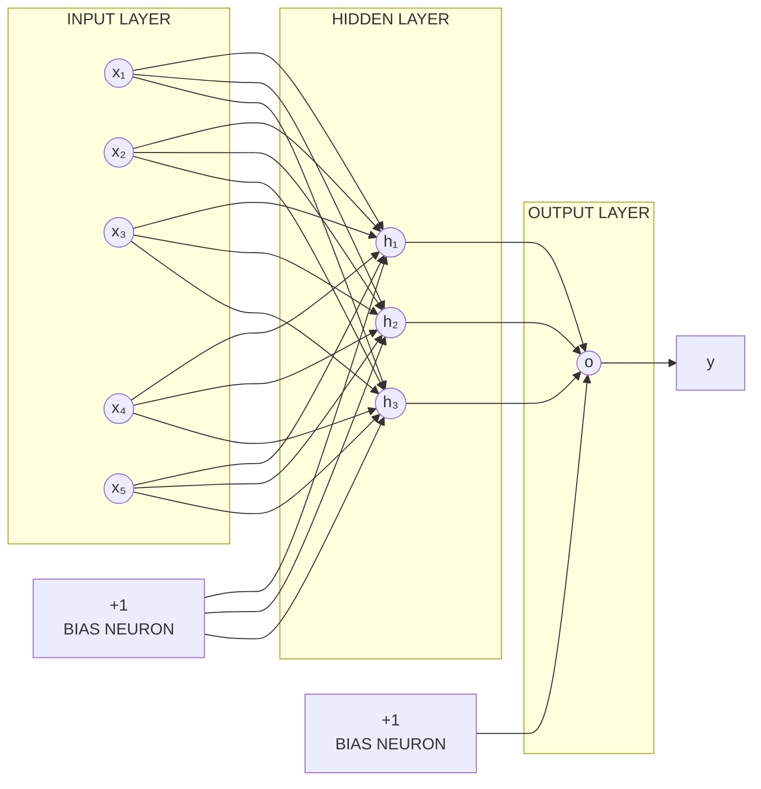
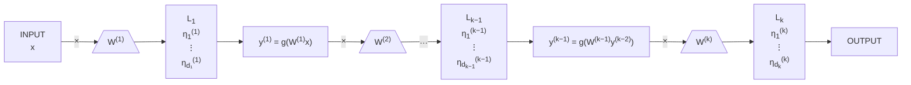
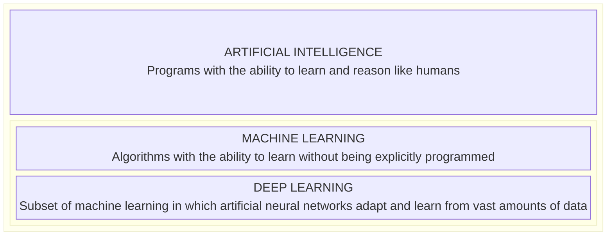
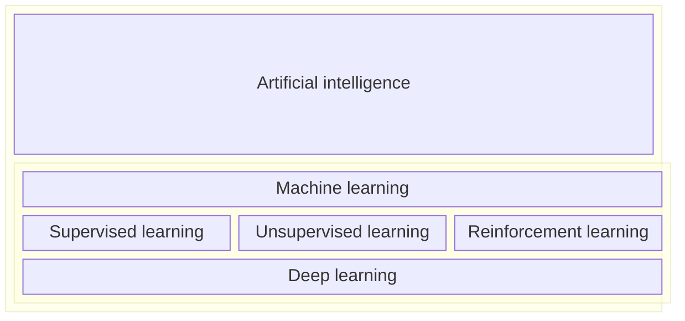

# Reti neurali

Le reti neurali, o ANN (Artificial Neural Network) è un metodo di machine learning che si ispira alla struttura e funzionamento di reti neurali biologiche presenti nei cervelli degli animali. 

Una rete neurale è formata da unità connesse fra loro, chiamati nodi, che simulano il compito di un neurone. Sono connessi fra di loro tramite degli archi che simulano le sinapsi tra neuroni biologici.

Ogni neurone artificiale riceve dei segnali dai neuroni connessi ad esso, processa questi input e invia dei segnali ai neuroni collegati ad esso.

Il "segnale" è rappresentato da un numero reale, e l'output di ogni neurone è calcolato da una funzione non lineare della somma dei suoi input, chiamata la "funzione di attivazione".

La "forza" della connessione del segnale è determinata dai "pesi", ed è la parte che viene aggiustata durante il processo di learning



# Percettrone

Il percettrone utilizza vari "neuroni" collegati ad un neurone finale per calcolare il valore dell'output. è visto come un modello a "sigolo strato", dato che contiene solo uno strato di neuroni:



Modelliamo un neurone in maniera semplice:

Un neurone può rievere segnali da altri neuroni, questi segnali sono combinati insieme, e se il risultato di questa combinazione supera una certa soglia, allora il neurone stesso lancerà un segnale, in caso che non superi la soglia, non fa nulla.

Possiamo modellare ciò vedendo come input numeri $x_1, ..., x_n$ a questo punto il neurone calcola $y = w_1 x_1 + ... + w_nx _n$ dove $w_1, ..., w_n$ sono i valori dei "pesi".

Se $y > t$, dove $t$ è un valore di "soglia", allora il neurone emette un segnale di "1" ai neuroni a cui è collegato, altrimenti il segnale avrà valore "0"

Il percettrone aggiunge un *bias* $b \in \mathbb{R}$ che viene aggiunto alla lista pesata dei neuroni, serve per aggiustare il "confine" del nodo finale.
- Con un bias $= 0$, il modello classificherà l'input solo in base al risultato dei neuroni
- Con un bias $>0$, il modello ha bisogno di un valore maggiore dai neuroni per potersi attivare
- Con un bias $<0$, il modello ha bisogno di un valore minore dai neuroni per potersi attivare

A questo punto, la funzione $g(x)$, ritorna 0 se $x <=$ 0 e 1 se $x > 0$. 

Per trovare il valore del percettrone, usiamo $y = g(w \cdot x + b)$  dove $y \in \{ 0, 1\}$.
Possiamo semplificare l'equazione rimuovendo il bias dalla equazione, e creando un nuovo neurone che ha come valore quello del bias

## Training del percettrone

Abbiamo un training set $D$ di $m$ esempi $e^{(1)}, ..., e^{(m)}$ dove ogni $e^{(i)}$ ha associato la label output $y^{(i)}$.
Fare il training del percettrone su $D$ vuol dire derivare i pesi $w_1, ... w_n$ che rendono le predizioni $\hat{y}^{(i)} = g(w \cdot e)$ il più vicino possibile a $y^{(i)}$ per $i = 1, ..., n$.

### Euristica di Rosenblatt

è una tecnica usata per fare training di un percettrone. 

Si parte da $w_1, ..., w_n$ inizializzati con valori randomici, a questo punto, per ogni esempio del training set con indice $i$ calcoliamo $\hat{y}^{(i)}$ come visto precedentemente, e aggiustiamo i pesi in questo modo:
$$
w_j = w_j + \lambda(y^{(i)} - \hat{y}^{(i)})x_j^{(i)}
$$
dove $\lambda > 0$ è un iperparametro chiamato il "learning rate".

Assumendo che $x_j^{(i)} > 0$, allora questo training funziona perchè:
- Se $y^{(i)} > \hat{y}^{(i)}$, allora $w_j$ incrementa, dato che $\lambda > 0$. Questo causerà $\hat{y}^{(i)}$ di aumentare il proprio valore, avvicinandosi al valore $y^{(i)}$ 
- Se $y^{(i)} < \hat{y}^{(i)}$, allora $w_j$ decresce. Questo causerà $\hat{y}^{(i)}$ di diminuire il proprio valore, avvicinandosi al valore $y^{(i)}$ 

In entrambi i casi, il valore del percettrone si avvicina a quello desiderato $^{(i)}$.

--- 
Questo ciclo viene eseguito più volte, dove ogni iterazione è chiamata "epoch" (epoca). L'algoritmo terminerà se arriva ad un numero massimo di iterazioni, o quando l'errore è abbastanza piccolo.

--- 
Se abbiamo una funzione di attivazione lineare $g(\cdot)$, il percettrone corrisponde ad un modello lineare che separa linearmente i dati. Questo funziona bene se i dati sono linearmente separabili.

**Linearly separable data**

```plot
x: [0, 5.6]
y: [0, 5]
axes: false
width: 400
height: 300
items:
  - line: [[0.65, 0.28], [4.73, 4.55]]
  - points: [[0.75, 1.15], [1.08, 1.20], [0.98, 1.57], [0.98, 2.13], [1.50, 2.26], [1.60, 1.80], [1.93, 2.45], [2.24, 2.53], [1.78, 2.95], [2.38, 2.95], [2.72, 2.99], [2.27, 3.52], [2.90, 3.38], [2.97, 3.92], [3.25, 4.16], [3.28, 3.82], [3.68, 3.97], [3.82, 4.35]]
    shape: dot
  - points: [[4.60, 3.77], [5.06, 3.97], [4.19, 3.28], [4.86, 2.99], [3.83, 2.95], [4.26, 2.70], [3.46, 2.68], [3.92, 2.33], [3.01, 2.38], [2.87, 1.83], [3.33, 1.87], [2.35, 1.57], [3.22, 1.42], [1.83, 1.09], [2.24, 0.91], [2.70, 1.06], [1.63, 0.48], [2.24, 0.42]]
    shape: plus
```

**Not linearly separable data**

```plot
x: [0.3, 7.2]
y: [0.8, 6.2]
axes: false
width: 400
height: 300
items:
  - points: [[2.03, 6.00], [1.44, 5.76], [1.96, 5.50], [2.47, 5.48], [1.02, 5.08], [1.61, 5.06], [2.15, 4.99], [1.26, 4.70], [1.96, 4.43], [5.72, 3.11], [6.04, 2.73], [5.41, 2.40], [5.89, 2.13], [6.66, 2.12], [5.45, 1.81], [4.81, 1.67], [5.46, 1.42], [6.10, 1.38]]
    shape: plus
  - points: [[5.76, 5.99], [6.32, 5.88], [6.84, 5.39], [5.57, 5.29], [6.30, 5.21], [6.10, 4.91], [6.61, 4.79], [5.56, 4.68], [6.32, 4.41], [0.71, 2.37], [1.27, 2.48], [1.80, 2.48], [2.24, 2.20], [1.37, 2.03], [2.17, 1.84], [0.83, 1.76], [1.89, 1.66], [1.26, 1.43], [2.11, 1.27]]
    shape: dot
```

Però, il percettrone, come anche altri modelli, possono usare funzioni di attivazioni non lineari.

# Percettrone multi livello

Il percettrone a singolo livello è molto limitato, ma diventa molto più interessante quando mettiamo in sieme (uno dopo l'altro), più strati.

A questo punto vediamo il percettrone in 3 strati principali
- L'input layer, che sono i neuroni iniziali con cui ci si interfaccia quando si da l'input da analizzare
- L'output layer è il neurone finale dove viene comunicato l'output
- L'hidden layer sono tutti gli strati intermedi tra l'input e l'ouput layer

**Perceptron**



**Multilayer perceptron (MLP)**



Questo percettrone è chiamato "multi level perceptron" o MLP.

Ha un numero fissato di $k$ strati, ed ogni strato $L_p$ ha un numero fisso di neuroni $d_p$. Ogni strato può avere un numero arbitrario di neuroni, eccetto l'ultimo che ne ha uno solo

Ogni neurone $\eta_u^{(p)}$, dello strato $L_p$, $u = 1, \dots, d_p$, riceve come input, gli output $y_1^{(p-1)}, \dots, y_{d_{p-1}}^{(p-1)}$ di tutti i neuroni $\eta_1^{(p-1)}, \dots, \eta_{d_{p-1}}^{(p-1)}$ dello strato precedente $L_{p-1}$.

L'output $y_u^{(p)}$ del neurone $\eta_u^{(p)}$ viene calcolata come una combinazione lineare dei suoi input  $y_1^{(p-1)}, \dots, y_{d_{p-1}}^{(p-1)}$ con i pesi $w_{1,u}^{(p)}, \dots, w_{d_{p-1},u}^{(p)}$, seguita dall'applicazione di una funzione di attivazione $g(\cdot)$:

$$
y_u^{(p)} = g\left( \sum_v w_{v,u}^{(p)} y_v^{(p-1)} \right)
$$

![[Pasted image 20241220125543.png]]

La matematica di un perceptrone multistrato può essere espressa in una forma più compatta e forse più comprensibile adottando una notazione matriciale.

Per semplificare la spiegazione di un layer con indice $p$, usiamo "$\text{in}$" per rappresentare l'input di questo strato (lo strato con indice $p - 1$), ed usiamo "$\text{out}$" per rappresentare l'output dello strato corrente (lo strato con indice $p$)

Sia $\mathbf{y}^\text{in} = (y_1^\text{in}, \dots, y_{d_\text{in}}^\text{in}) \in \mathbb{R}^{d_\text{in}}$ un vettore (colonna) $d_\text{in}$-dimensionale contenente gli output dello strato di input $L_\text{in}$.

Sia $\mathbf{W} \in \mathbb{R}^{d_\text{out} \times d_\text{in}}$ una matrice $(d_\text{out} \times d_\text{in})$-dimensionale che raccoglie tutti i pesi dallo strato di input (dimensione $d_\text{in}$) allo strato di output (dimensione $d_\text{out}$), ovvero:

$$
\mathbf{W^\text{out}} =
\begin{bmatrix}
w_{1,1}^\text{out} & \dots & w_{d_\text{in},1}^\text{out} \\
\vdots & \ddots & \vdots \\
w_{1,d_\text{out}}^\text{out} & \dots & w^\text{out}_{d_\text{in},d_\text{out}}
\end{bmatrix}
$$

Le uscite $\mathbf{y}^\text{out} = (y_1^\text{out}, \dots, y_{d_\text{out}}^\text{out}) \in \mathbb{R}^{d_\text{out}}$ possono essere espresse come:

$$
\mathbf{y}^\text{out} = g\left( \mathbf{W}^\text{out} \mathbf{y}^\text{in} \right)
$$

dove $g(\cdot)$ è applicata elemento per elemento a tutte le componenti del vettore $\mathbf{W}^\text{out} \mathbf{y}^\text{in}$.



A questo punto denotiamo $f^{(p)}$ come la funzione $\mathbf{y}^{(p)} = g\left( \mathbf{W}^{(p)} \mathbf{y}^{(p-1)} \right)$ dello strato $L_p$ i un MLP a $k$ strati. 
Abbiamo $x$ l'input dato all'MLP, allora la funzione finale che rappresenta l'intero MLP sarà del tipo:

$$
\begin{aligned}
M L P(\boldsymbol{x}) &= 
\left(f^{(k)} \circ f^{(k-1)} \circ \cdots \circ f^{(2)} \circ f^{(1)}\right)(\boldsymbol{x}) \\
&=f^{(k)}\left(f^{(k-1)}\left(\cdots\left(f^{(2)}\left(f^{(1)}(\boldsymbol{x})\right)\right)\right)\right)
\end{aligned}
$$

Nel caso in cui tutte le funzioni di attivazione siano lineari, le funzioni effettuerebbero semplicemente una moltiplicazione, a questo punto potremmo rappresentare il tutto tramite una produttoria dei pesi, ma a questo punto stiamo creando l'equivalente di un percettrone a singolo strato.

--- 
Gli MLP sono considerati come "feed forward neural networks", cioè che i dati fluiscono da sinistra verso destra (da input ad output)

# Funzione di attivazione

Si può modificare le funzioni di attivazione all'interno di un MLP in maniera da migliorare il learning del modello e gestire task che non sono solo quelli di classificazione binaria.

Di solito la funzione di attivazione è definita come un iperparametro e scelto durante la fase di training tramite lo step di validazione. 

## ReLU

La funzione di attivazione ReLU è quella più consigliata per la maggior parte dei MLP.
é una funzione non lineare ma che rimane molto vicina ad essere lineare, infatti è "lineare in parti", perchè è una funzione che continene due "parti" lineari. 

Dato che è quasi lineare, conserva molte proprietà dei modelli lineari, ed è facile da ottimizzare tramite metodi del gradiente, spesso usati per allenare gli MLP

$$
r(x)=\max \{0, x\}= \begin{cases}0, & x<0 \\ x, & x \geq 0\end{cases}
$$

```plot
x: [-10.5, 10.5]
y: [-0.5, 10.5]
height: 260
grid: true
ticks: true
xticks: [-10, -7.5, -5, -2.5, 0, 2.5, 5, 7.5, 10]
yticks: [0, 2, 4, 6, 8, 10]
caption: ReLU Activation Function
items:
  - fn: max(0, x)
    color: blue
  - text: $\max(0,x)$
    at: [6.5, 1]
```

## Funzione sigmoidea

è la più comune approssimazione alla funzione "step", è monotona crescente ed ha limite 0 quando tende a $-\infty$ e ad 1 quando tende a $+\infty$ 

$$
sigm(x) = \frac{1}{1+e^{-x}}
$$

```plot
x: [-6, 6]
y: [0, 1]
height: 280
grid: true
xticks: [-6, -4, -2, 0, 2, 4, 6]
yticks: [0, 0.5, 1]
items:
  - fn: 1/(1 + exp(-x))
    color: blue
```

## Funzione iperbolica

è monotona crescente, ed ha limite -1 quando tende a $-\infty$ e ad 1 quando tende a $+\infty$ 

```plot
x: [-2.8, 2.8]
y: [-1.4, 1.4]
height: 260
grid: true
xticks: [-2, -1, 1, 2]
yticks: [-1, 1]
xlabel: $x$
ylabel: $\tanh(x)$
items:
  - fn: tanh(x)
    color: red
    width: 3
```

## Arctan 

è l'inverso della funzione tangente, è monotona crescente, ed ha limite $-\frac{\pi}{2}$ quando tende a $-\infty$ e ad $\frac{\pi}{2}$ quando tende a $+\infty$ 

```plot
x: [-4.8, 4.8]
y: [-2.1, 2.1]
height: 260
grid: true
xticks: [-4, -3, -2, -1, 1, 2, 3, 4]
yticks: { "pi/2": "$\\frac{\\pi}{2}$", "-pi/2": "$-\\frac{\\pi}{2}$" }
xlabel: $x$
ylabel: $\arctan(x)$
items:
  - fn: atan(x)
    color: red
    width: 3
```

## Softmax

è una funzione che converte un vettore $d$-dimensionale in un vettore di valori reali che contiene la distribuzione di probabilità, cioè normalizzarle ad un valore compreso fra 0 e 1, e che sommano tutti ad 1. 

$$
\sigma:\mathbb{R}^d \rightarrow (0,1)^d
$$
Softmax:

$$
\sigma(\boldsymbol{x})_i=\frac{e^{x_i}}{\sum_{j=1}^d e^{x_j}}
$$

è principalmente usato nell'output layer

# Loss function

Fare il training di un modello richiede trovare i migliori pesi $W = \{W^{(1)}, ..., W^{(k)}\}$  che minimizzano la "distanza" fra l'esempio in $D$ e il proprio label.

Questa funzione che calcola la distanza è chiamata la "loss function", formalmente espressa come $l: \mathbb{R}^n \times R^{n^\prime} \rightarrow \mathbb{R}$ che calcola la distanza $l(f_w(x_i), y_i)$ fra la label $f_w(x_i)$ calcolata dall'MLP e la vera label $y_i$. Se la differenza è un valore grande, allora vuol dire che sia numericamente che "concettualmente", i due risultati sono molto differenti. 

Questo è applicato su un singolo esempio del dataset, possiamo definire la funzione che calcola l'errore complessivo semplicementte effettuando una somma pesata di ogni esempio nel dataset 

$$
\mathcal{L}\left(\boldsymbol{W}, f_W, D\right)=\frac{1}{|D|} \sum_{\left(\boldsymbol{x}_i, y_i\right) \in D} \ell\left(f_W\left(\boldsymbol{x}_i\right), \boldsymbol{y}_i\right) .
$$

e quindi possiamo definire il problema di ML come un problema di ottimizzazione, dove dobbiamo minimizzare:

$$
argmin_w \ \mathcal{L}(W, f_w, D)
$$

## Gradient descent

Questo problema di ottimizzazione può essere risolto tramite una tecnica di ottimizzazione chiamata "gradient descent", che è l'opposto dell'algoritmo di hill climbing.

è una funzione definita come $\phi: \mathbb{R}^d \rightarrow \mathbb{R}$, la "direzione" dello steepest descent in un punto $z \in \mathbb{R}^d$ corrisponde al negativo del gradiente di $\phi$ in $z$, denotato come:

$$
\nabla_z \phi=\left(\frac{\partial \phi}{\partial x_1}(\mathbf{z}), \ldots, \frac{\partial \phi}{\partial x_d}(\mathbf{z})\right) .
$$

che contiene le derivate parziali di $\phi$ su $z$ 

Il gradient descent inizia ad un punto casuale $z \in \mathbb{R}^d$, ed applica iterativamente:
- Calcola la direzione del deepest descent in $z$, cioè $-\nabla_z \phi$ 
- Aggiorna $z$ facendo un passo verso la direzione del steepest descent, cioè: $z = z - \lambda\nabla_z \phi$ dove $lambda > 0$ è un iper parametro chiamato il "learning rate" che dice "quanto grande" è il passo da fare verso lo steepest descent
fino a quando $z$ non decresce più la funzione obiettivo, e quindi si è arrivati ad un minimo locale

![[Pasted image 20241220143619.png]]

Nel contesto del MLP, il gradient descent è applicato durante la fase di training, applicandola ai pesi $W$ per minimizzare la funzione obiettivo $\phi = \mathcal{L}(W, f_w, D)$ 

Ora lo step chiave è di calcolare il gradiente della funzione $\phi$, che può essere complesso, dato che la funzione $f_w$ implementata nell'MLP potrebbe essere molto complessa, dato che può essere composizione di molte funzioni, una per ogni layer.

Un modo per risolvere ciò sarebbe di applicare la "chain rule". Possiamo vedere la funzione da analizzare dell'MLP come:

$$
M L P(\boldsymbol{x})=\left(f^{(k)} \circ f^{(k-1)} \circ \cdots \circ f^{(2)} \circ f^{(1)}\right),
$$

La chain rule ci dice che la derivata $D(f_1 \circ f_2) = (D f_1 \circ f_2)D f_2$, dove $Df$ indica la derivata di $f$. 
A questo punto possiamo applicare ricorsivamente la chain rule per ottenere: 

$$
D(f_1 \circ ... \circ f_n) =
\prod_{k=1}^n\left(D f_k \circ f_{(k+1) .. n}\right)
$$

dove $f_{a . . b}=f_a \circ \cdots \circ f_b$  

## Back propagation

Eseguendo l'applicazione ricorsiva della chain rule ci potrebbe portare ad una duplicazione della stessa derivata, ripetendo inutilmente dei calcoli. 

Per evitare ciò possiamo usare un approccio di programmazione dinamica, chiamato "back propagation". 
è chiamata in questo modo perchè l'algoritmo prima effettua un passo in "avanti" dove le derivate di ogni strato sono calcolate e salvate, per poi effettuare un passo "indietro" dove i gradienti vengono calcolati, muovendosi dall'ultimo al primo strato, combinando tramite programmazione dinamica, le derivate intermedie usate durante il forward pass

--- 

Il gradient descent ha delle limitazioni:
- funziona solo se la funzione da minimizzare è differenziabile, cosi da poter calcolare il gradiente 
- ci si potrebbe fermare ad un minimo locale 
- scegliere un $\lambda$ corretto è difficile, se usiamo un $\lambda$ troppo grande, potremmo saltare il minimo, se $\lambda$ è piccolo, potremmo convergere troppo lentamente
- aumentare il numero degli strati potrebbe causare i gradienti di diventare molto piccoli o molto grandi, causando problemi di rappresentazione numerica
  - Durante lo step backward, durante il calcolo dei gradienti dall'output layer all'input layer, i gradienti diventano man mano più piccoli più andiamo avanti, convergendo a 0. Questo causa i pesi ad essere aggiornati in maniera minima, e quindi mai convergere al minimo locale
  - Allo stesso modo, i gradienti potrebbero essere molto grandi, causando grandi cambiamenti nei pesi, causando il modello a divergere. 

## Gradient descent stocastico 

Calcolare l'errore complessivo del dataset ad ogni step del gradient descent può essere molto dispendioso. Per risolvere questo problema, usiamo una variante del gradient descent che approssima $\mathcal{L}(W, f_w, D)$ calcolando la loss function solo su un subset (piccolo) di $M \subseteq D$, che chiamiamo "minibatch", e quindi calcolando la somma della loss function complessiva solo su questo subset.

- Usiamo l'intero training set D che è mischiato "randomicamente" e suddiviso in minibatch.
- Ogni minibatch è usato come singolo step del gradient descent 
- Una volta aver processato tutti i minibatch, ci ritroviamo al punto in cui abbiamo analizzato tutti i dati nel nostro dataset, quindi consideriamo questo come una singola epoca di training
- Ripetiamo questo proccesso (randomizzando $D$ ogni volta) per un certo numero di epoche.

**for** a fixed number of epochs **do**
- shuffle training set $D$ and split it into minibatches
- **for** every minibatch $M$ **do**
  - compute $f_{\boldsymbol{W}}(\boldsymbol{x}_i)$ (output of the MLP given current weights $\boldsymbol{W}$) for every $(\boldsymbol{x}_i, \boldsymbol{y}_i) \in M$
  - compute (approximate) loss $\hat{\mathcal{L}} = \frac{1}{\lvert M\rvert}\sum_{(\boldsymbol{x}_i,\boldsymbol{y}_i)\in M} \ell(f_{\boldsymbol{W}}(\boldsymbol{x}_i), \boldsymbol{y}_i)$
  - compute gradient $\nabla_{\boldsymbol{W}}\hat{\mathcal{L}}$ of $\hat{\mathcal{L}}$
  - take a step of gradient descent: update current weights $\boldsymbol{W}$ as $\boldsymbol{W} \leftarrow \boldsymbol{W} - \lambda\nabla_{\boldsymbol{W}}\hat{\mathcal{L}}$
- **endfor**

**endfor**

# Loss functions

Elenchiamo alcune loss function più usate. 
Indicheremo con $\hat{y} = f_w(x)$ è la predizione, mentre $y$ la label corretta.
### $L_p$ distance 
è una metrica utile per problemi di regressione, la dimensionalità di $\hat y$ e $y$ deve essere uguale. 

$$
\ell(\widehat{\boldsymbol{y}}, \boldsymbol{y})=\|\widehat{\boldsymbol{y}}-\boldsymbol{y}\|^p
$$

### NLL (Negative log-likelihood)
Assumiamo che ogni elemento di $\hat y$ rappresenti la probabilità che quell'esempio faccia parte di una certa classe, e che la classe corretta sia il $q$-esimo elemento.

$$
\ell(\widehat{\boldsymbol{y}}, \boldsymbol{y})=- log \ \hat y_q
$$

### CE (Cross entropy)

La funzione NLL richiede che i valori $\hat y$ rappresentino una distribuzione di probabilità.
il CE è semplicemente la funzione NLL ma che trasforma, tramite uno strato softmax, qualsiasi vettore numerico in una distribuzione di probabilità.

Softmax:

$$
\operatorname{SOFTMAX}(\widehat{\boldsymbol{y}})=\frac{e^{\hat{y}_i}}{\sum_{j=1}^n e^{\hat{y}_j}}

$$
CE:

$$
\ell(\widehat{\boldsymbol{y}}, \boldsymbol{y})=-\log \frac{e^{\widehat{\boldsymbol{y}}_q}}{\sum_{j=1}^n e^{\hat{\boldsymbol{y}}_j}}=-\widehat{\boldsymbol{y}}_q+\log \sum_{j=1}^n e^{\hat{\boldsymbol{y}}_j}
$$

### BCE (Binary cross entropy)

Corrisponde a NLL però nel caso di classificazione binaria. Assume che $\hat y \in [0,1]$ sia uno scalare e che $y \in \{0,1\}$ sia uno scalare.
$\hat y$ rappresenta la probabilità che $y = 1$, e $1-\hat y$ rappresenta la probabilità che $y = 0$ 

$$ 
\ell(\mathbf{y}, \hat{\mathbf{y}}) = - \left( \mathbf{y} \log \hat{\mathbf{y}} + (1 - \mathbf{y}) \log(1 - \hat{\mathbf{y}}) \right) 
$$

# Deep learning vs Machine learning vs AI
Il termine **deep learning** si riferisce a un insieme di tecniche di **machine learning** in cui i modelli sono rappresentati come **circuiti algebrici complessi**, con connessioni i cui pesi (o "forze") possono essere modificati durante l'addestramento.

La parola "deep" ("profondo") indica che questi circuiti sono organizzati in **molti strati**: ciò implica che i percorsi di calcolo dagli input agli output attraversano numerosi passaggi.

Questi circuiti algebrici corrispondono a **reti neurali artificiali**. Di conseguenza, il deep learning utilizza reti neurali con **molti strati di neuroni artificiali connessi tra loro**.





## Teorema dell'approssimazione universale

è un teorema molto importante sulla rappresentazione e potenza approssimativa delle reti neurali di funzioni arbitrarie.

Il teorema dice che un MLP con solo 1 output layer lineare e un hidden layer con qualsiasi funzione di attivazione non lineare, può approssimare qualsiasi funzione *Borel* misurabile, cioè qualsiasi funzione continua su un sottoinsieme chiuso e delimitato di $\mathbb{R}^n$, con qualsiasi errore non zero desiderato, a condizione che siano dati abbastanza hidden units. 

Quindi ci dice che un MLP con un singolo hidden layer (ma non ci dice quanto grande questo hidden layer sia) riesce ad approssimare qualsiasi funzione Borel misurabile con un arbitrario livello di precisione. 

---
Di solito, in pratica, nelle deep MLP, rappresentazioni più complesse sono costruite sopra rappresentazioni più semplici, arrivando ad una rappresentazione man mano più astratta e significativa.

![[Pasted image 20241220164232.png]]
