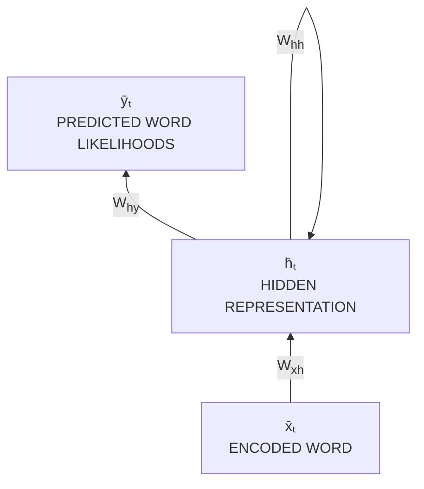
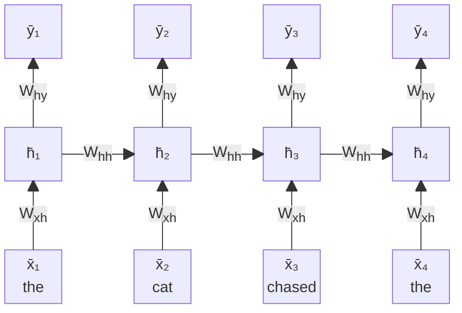
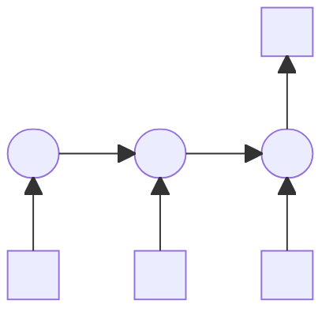
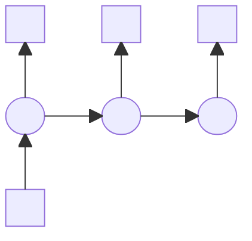
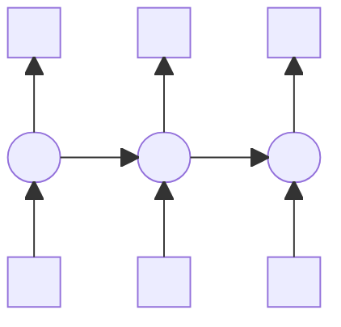
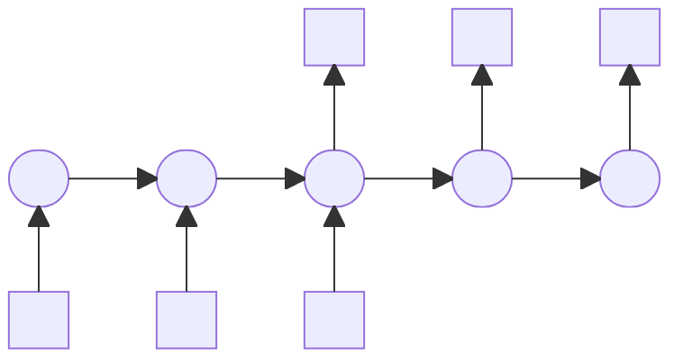
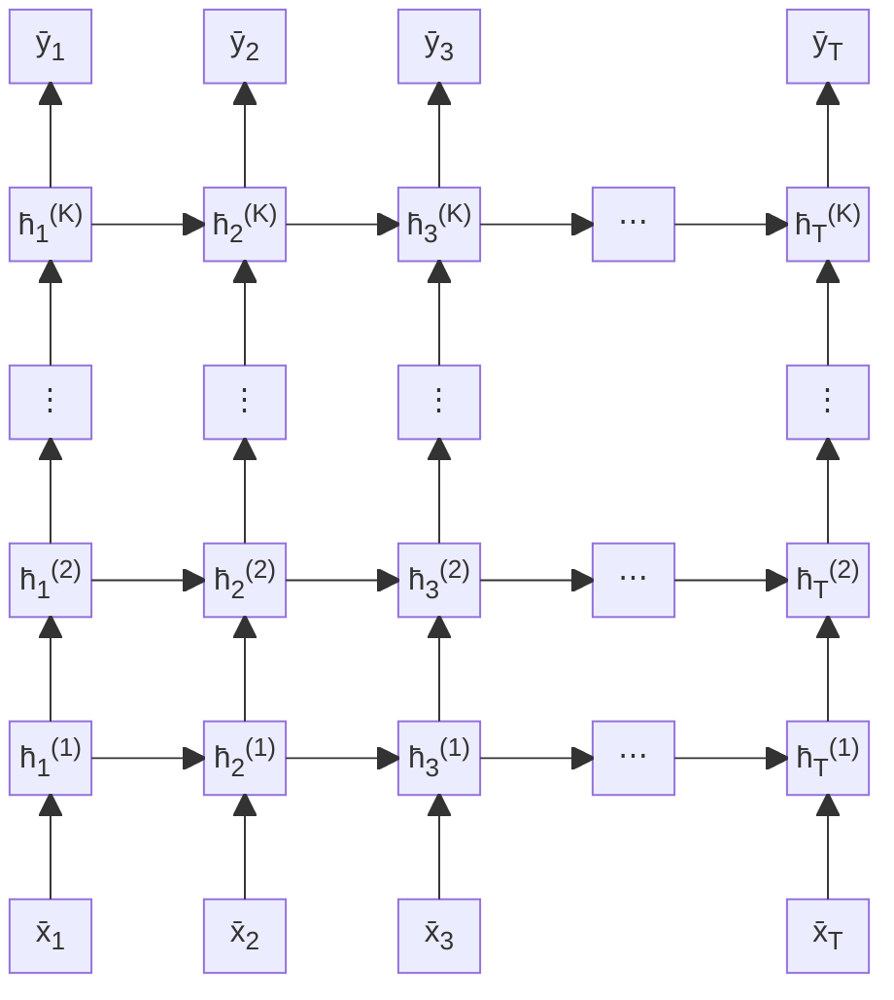
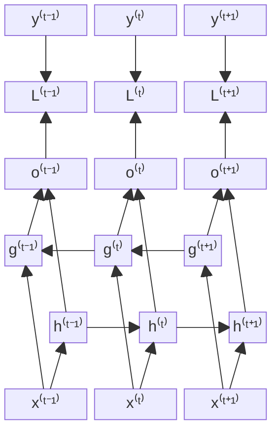

# Sequence modeling

I modelli Sequence sono modelli di machine learning che processano e/o restituiscono sequenze di dati (come per esempio liste ordinate di simboli o numeri), tenendo in conto le dipendenti sequenziali al proprio interno.

Per esempio, nel testo, l'ordine delle parole in una frase è molto importante, e anche se usano le stesse parole, la struttura di una frase scritta in un determinato modo può avere un significato molto differente rispetto ad un altra che usa le stesse parole
Per esempio "il gatto insegue il topo" contro "il topo insegue il gatto". Esempi di sequence modeling:

- **Time series** forecasting 
- **Speech** recognition 
- **DNA** sequence analysis 
- **Code** generation 
- **Music** generation/transcription 
- **Temporal** graph processing

# Natural Language Processing (NLP)

NLP studia l'interazione tra i computer e il linguaggio umano, in particolare come un programma analizza grandi quantità di nati in linguaggio naturale.

Lo scopo del computer è "capire" i contenuti di documenti, incluse le regole del linguaggio, ed estrarre informazioni utili.

# Recurrent neural networks (RNN)

è un tipo di rete neurale artificiale progettata per trattare sequenze di dati, come testo, audio, o serie temporali. Le RNN daranno come risultato una "lista" di elementi, e questi elementi vengono creati uno ad uno.
A differenza delle reti neurali tradizionali (feedforward), che trattano i dati come un input singolo per volta (e quindi perdono contesto delle generazioni precedenti), le **RNN** hanno la capacità di "memorizzare" informazioni provenienti dai passaggi precedenti attraverso **connessioni ricorrenti**. Questo le rende particolarmente utili per compiti in cui l'ordine o la dipendenza temporale degli input è importante.
Per esempio, in una risposta di 3 elementi, per poter predirre il secondo (e terzo) elemento, dobbiamo sapere quali sono stati gli elementi precedentemente generati.

L'idea dietro il RNN è di tenere uno stato interno chiamato "hidden representation/state" che è aggiornato ogni volta che un nuovo input deve essere computato. In questo modo si tiene una "storia" dei passati input.

Si può simulare una RNN tramite l'unrolling, cioè applicare esattamente quello che farebbe una RNN, ma usando tante MLP, il cui output viene usato come input nella prossima fase

unrolling ⇒

**many-to-one**

**one-to-many**

**many-to-many**

**many-to-many**

**many-to-one**, e.g., *text classification, sentiment classification*

**one-to-many**, e.g., *image captioning* (from an image to a sequence of words)

**many-to-many**, e.g., *machine translation, question answering*

Il training di un RNN unrolled è simile a quello di una normale rete neurale.
- la funzione loss è applicata all'ultima rete
- si usa una variante di gradient descent che usa BPTT (backpropagation through time) che tiene conto che l'input è una sequenza e che i parametri sono condivisi fra i vari strati dell'RNN unrolled

RNN layers can be *stacked*, so as to make the RNN *deeper*.

The only difference w.r.t. single-layer RNN is that *the first layer only depends on the input*, while the internal layers depend on the previous layers.

Formally:

$$
\begin{aligned}
\bar h_t^{(1)} &= g\left(W_{xh}\bar x_t + W_{hh}^{(1)}\bar h_{t-1}^{(1)}\right), &&\forall t \in [1..T] \\
\bar h_t^{(k)} &= g\left(W_{hh}^{(k)}\left[\bar h_t^{(k-1)}, \bar h_{t-1}^{(k)}\right]\right), &&\forall k \in [2..K],\, t \in [1..T] \\
\bar y_t &= W_{hy}\bar h_t^{(K)}, &&\forall t \in [1..T]
\end{aligned}
$$

The resulting unrolled deep RNN is a *bidimensional* computational graph. It can still be trained via *BPTT*.

Le RNN più performanti sono di solito multilayer, e si è visto che 2 strati sono molto meglio di 1 strato, ma 3 è minimamente meglio di 2, e che per migliorare le RNN più profonde si deve usare le "residual connections" 

![[Pasted image 20241220171316 figura.png]]

A.k.a. RNN with *skip-connections* or *residual networks* (ResNet).

*Idea*: add the output of the previous layer directly to the result of the next layer:

$$
\begin{aligned}
\bar h_t^{(1)} &= g\left(W_{xh}\bar x_t + W_{hh}^{(1)}\bar h_{t-1}^{(1)}\right) + \bar x_t, &&\forall t \in [1..T] \\
\bar h_t^{(k)} &= g\left(W_{hh}^{(k)}\left[\bar h_t^{(k-1)}, \bar h_{t-1}^{(k)}\right]\right) + \bar h_t^{k-1}, &&\forall k \in [2..K],\, t \in [1..T]
\end{aligned}
$$

This trick is beneficial for *vanishing gradients* (due to the use of *summation*).

Oppure potrebbe essere utile "andare in avanti" nella sequenza per capire meglio la semantica della sequenza (in confronto a guardare solo indietro).

é formata da due RNN indipendenti, una processa l'input normalmente, mentre l'altra processa l'input in ordine inverso. Il risultato finale è la concatenazione dei due 

---
Il problema di questo approccio di RNN è che funziona solo per sequenze corte, principalmente per colpa di:

- Vanishing gradients, più è lunga la sequenza, più è il numero di unrolled RNN, e dato che i gradienti sono calcolti ad ogni step della catena di RNN, diventano man mano più piccoli strato dopo strato, e quindi i primi strati hanno meno effetto sull'output. 
- Capacità di rappresentazione limitata, è un problema intrinseco del architettura del modello, dato che l'hidden state è unico ed esso viene riscritto continuamente, rende l'architettura troppo semplice, e non capace di trattare sequenze più lunghe

# Long Short-Term Memory LSTM
è un tipo particolare di RNN, ma ha la differenza che ogni cella individuale del LSTM non è una semplice rete neurale, ma può essere molto più sofisticata. Sono state ideate per risolvere i problemi di Vanishing gradient. Risolve ciò aggiungendo un nuovo elemento, la short term memory. Una unità di LSTM ricorda valori su intervalli di tempo arbitrari, e le porte di ogni unità decidono quale informazioni "dimenticare"

Una singola unità di un LSTM è formata da 3 porte:
- Input gate
- Output gate, decide quali informazioni la cella corrente deve passare alla cella successiva.
- Forget gate, decide quale informazione da rimuovere dalla memoria, con un valore (arrotondato) a 0 dice che quell'informazione va dimenticata, mentre un valore arrotondato a 1 dice di mantenerla.

![[Pasted image 20241220172802.png]]
