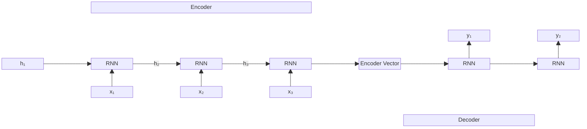
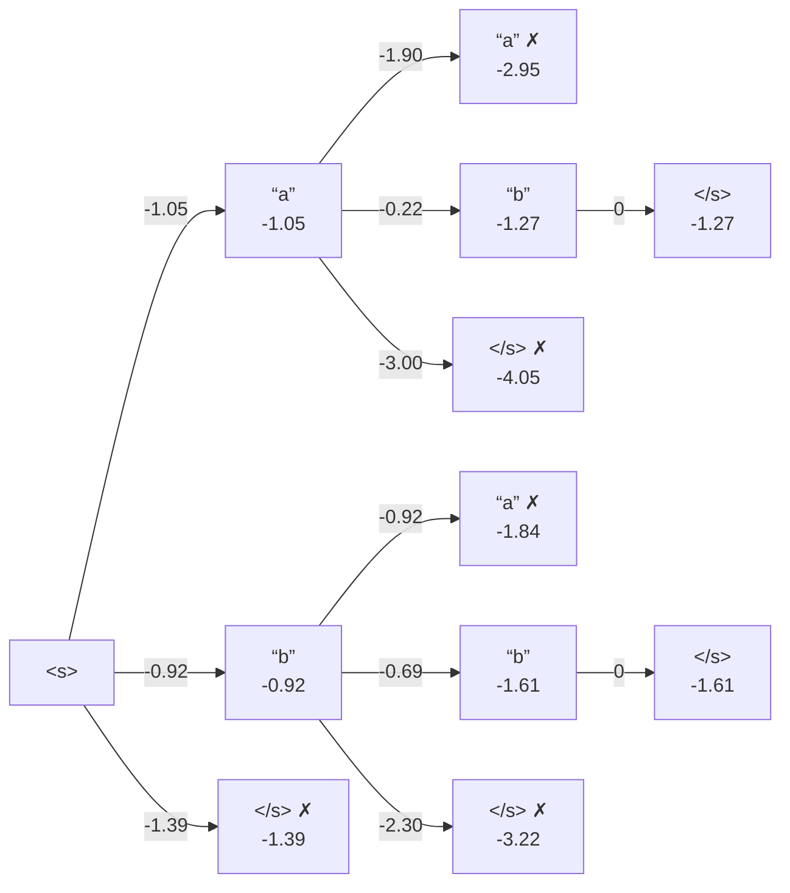
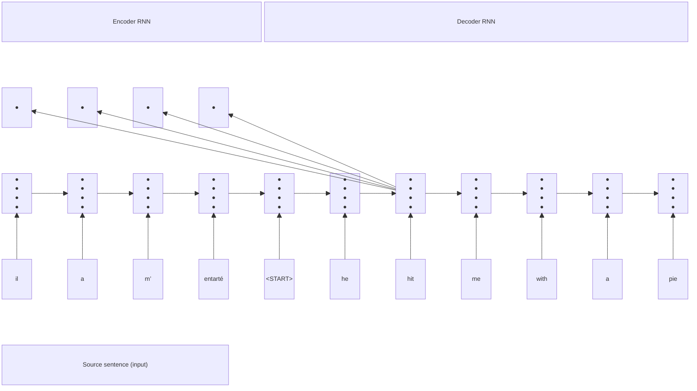
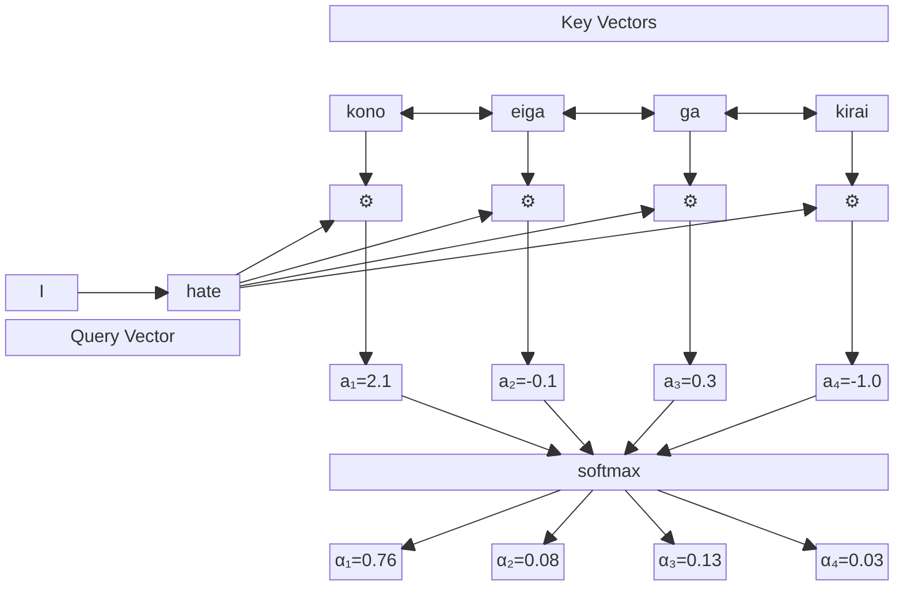
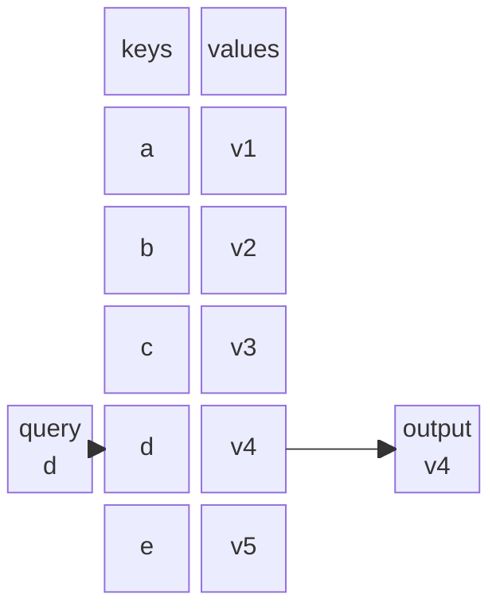
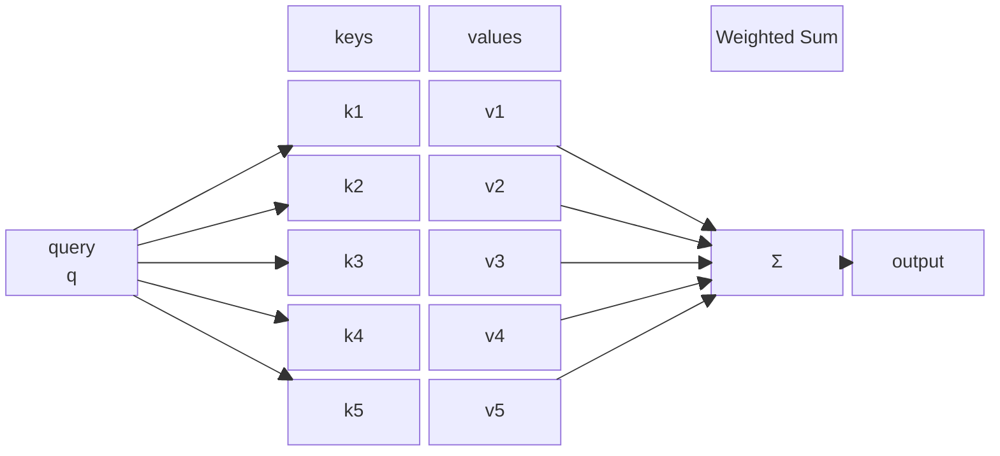

# Seq2Seq

Il Sequence to Sequence modeling è il task che mappa una sequenza in input, ad una sequenza in output, senza alcuna assunzione sulla lunghezza delle due sequenze. 
è molto usata in problemi NLP: traduzione, generazione codice, riassunto di testo, risposte a domande. 
Ma viene usato anche in: trascrizione audio/video, peptide-binding protein prediction.

# Architettura encoder-decoder

è un esempio di architettura per implementare seq2seq, suddivisa in due parti principali:
- **Encoder** è una RNN che codifica la sequenza in input in un vettore numerico che rappresenta una versione compressa del dato in input. Il modello usato nell'encoder ha il compito di imparare come comprimere i dati in input in un "latent space", che è uno spazio con dimensionalità minore dell'input che raccoglie le feature "essenziali" dei dati in input. è importante specificare che il vettore in cui è stato convertita la sequenza in input è di dimensione *FISSA*, il che potrebbe creare problemi dato che è impossibile salvare tutte le informazioni necessarie in un dato che è potenzialmente di dimensione minore rispetto all'input.
- **Decoder** è una RNN che decodifica il vettore codificato in una sequenza di output

Come si può notare, per poter creare un training set, è necessario fornire sia input che un output per ogni esempio del dataset. Nel vocabolario gestito dalle RNN viene aggiunto anche due token speciali, uno che rappresenta l'inizio e uno che rappresenta la fine della sequenza.

Di solito dato un training set, l'allenamento del modello funziona con il dare l'input all'RNN encoder, per poi permettere al decoder di predirre la sequenza in output tramite l'output dell'encoder, per poi comparare il risultato con il valore effettivo per quella coppia di valori tramite una loss function, con lo scopo di minimizzare la differenza.

---
L'inferenza può esser vista come esser fatta dalla RNN decoder. 
Ad ogni step, il decoder da in output una distribuzione di probabilità di un set di elementi (parte del vocabolario).
Possiamo scegliere tra questi elementi in vari modi, con la soluzione "greedy" possiamo semplicemente scegliere l'elemento con la più alta probabilità, ma questa soluzione rende il modello troppo selettivo.

Un alternativa è il **Beam search**:
Seleziona $k \geq 1$  intero che rappresenterà il numero di sottosequenze che verranno mantenute ad ogni passaggio.

Vediamo il compito di scegliere la prossima sequenza come un albero, dove la nostra sequenza finale sarà rappresentata da un cammino dalla sorgente alla foglia. La sorgente avrà il simbolo di inizio, e le foglie conterrano il token di fine. 

Nel primo step dell'algoritmo dobbiamo scegliere, fra tutti i possibili token della prossima sequenza, i migliori $k$.
Una volta scelti questi k simboli, scartiamo tutti gli altri dall'albero e continuiamo la generazione di sequenza solo sui $k$ simboli scelti. 

Nelle prossime iterazioni continuiamo a fare lo stesso su tutte le sottosequenze ancora "aperte". Una volta che tutte le sottosequenze raggiungono la fine (hanno generato il token di fine), abbiamo le nostre sequenze candidate. 

---
Nei problemi di NMT (Neural Machine Translation), spesso si usa un architettura encoder-decoder. Negli ultimi anni si sta rimpiazzando l'uso di RNN al suo interno per l'architettura *Transformer*

# Attention

Come detto in precedenza, l'encoder *comprime* e codifica la sequenza in input in un vettore numerico *di dimensione fissa*. La compressione a dimensione fissa non può mantenere tutte le informazioni dell'input originale, e quindi si comporta come un *information bottleneck* facendo perdere informazioni utili nell'input.

Per mitigare ciò si è creato un una nuova tecnica chiamata *Attention*, dove ogni step del decoder può "guardare" direttamente le diverse parti della rappresentazione dell'input durante i vari stati della fase di encoding, assegnando pesi diversi ad ogni parte per modificarne l'influenza, permettendo l'uso di informazioni "meno compresse" durante la fase di decoding.

Ogni passo del decoder effettua una combinazione convessa di tutti gli output degli encoder. 

- **Output di un encoder**, sono gli hidden state, per ogni passo dell'encoder abbiamo un vettore di numeri, quindi la sequenza finale dell'encoder non è più un vettore numerico, ma un vettore di vettori numerici: $h_1, ..., h_t \in \mathbb{R}^a$ , dove $a$ è la dimensione dei vettori degli encoder, mentre $T$ è la lunghezza dell'input
- **Stato nascosto del decoder**, at uno step $t$, lo stato $s_t = f(s_{t-1}, t_{t-1}, c_t) \in \mathbb{R^b}$, dove $f$ è applicato sullo stato nascosto del decoder precedente ($s_{t-1}$), l'output del decoder precedente $y_{t-1}$ ed un "contesto" $c_t$. 
  - Nel caso di un encoder-decoder che non usa attention, allora $c_t = h_T$ se $t = 1$, altrimenti $c_t = 0^a$
  - Nel caso di un encoder-decoder che usa attention, allora $\mathbf{c}_t=\sum_{i=1}^T \alpha_i \mathbf{h}_i$ cioè una combinazione convessa tra l'output dell'encoder $h_i$ e i pesi di *attention* $\alpha_i$ 
- **Pesi dell'attention**: $[\alpha_1, ...,\alpha_T ] = softmax(e_1, ..., e_T) \in \mathbb{R}^T$, cioè $\alpha_i=\exp \left(e_i\right) / \sum_{j=1}^N \exp \left(e_j\right) \in \mathbb{R}$  dove $e_i = a(s_{t-1}, h_i) \in \mathbb{R}$ è un numero reale che è il risulttato della combinazione di $s_{t-1}$ e $h_i$ che di solito è il prodotto scalare.
Da notare che i pesi dell'attention sono imparati *indirettamente* come visto nel punto precedente, e quindi non vengono "allenati" ma imparati dinamicamente durante l'esecuzione.

L'attention risolve il problema del bottleneck di informazioni, rendendo possibile al decoder di visualizzare direttamente l'input sorgente. 

Aiuta con il problema del vanishing graddient, dato che permette la visione di stati lontani

Fornisce un modello di learning più simile a quello umano, dove per produrre la sequenza di decoding, si deve spesso tornare a controllare cosa si è fatto in precedenza per capire cosa fare dopo.

Tramite i pesi di attention si può capire più facilmente quali parti dell'input sono più importanti per produrre una parte specifica della sequenza in output.

In a **lookup table**, we have a table of **keys** that map to **values**. The **query** matches one of the keys, returning its value.

In **attention**, the **query** matches all **keys** *softly*, to a weight between 0 and 1. The keys' **values** are multiplied by the weights and summed.

---
Si può anche usare il *Self attention* quando per processare uno step della sequenza si usano gli altri step precedentemente processati, questo permette di aggiungere il concetto di attention anche nella fase di decoding.

---
Un altra variante ancora è il _Multi-head attention_ che utilizza più moduli di attenzione in parallelo, ognuno con una versione diversa della query (chiamata "head"), ottenuta tramite trasformazioni lineari apprese. L'output finale è la concatenazione dei risultati delle varie head, ognuna delle quali può concentrarsi su parti diverse dell'input, rendendo il modello più flessibile e potente. Ad esempio, una head può imparare a collegare i verbi ai loro soggetti, mentre un'altra può collegare i pronomi ai loro riferimenti.

# Architettura transformer

L'architettura transformer dice l'attention è l'unica cosa necessaria, e non c'è bisogno della ricorrenza. 

Gli RNN durante lo step $t$ del processamento della sequenza output, producono una rappresentazione cumulativa delle sottosequenze da step $1$ a step $t$, che è dipendente da tutti i simboli delle sequenze fino a $t$

Nell'architettura *Transformer*, l'input è convertito nella sua rappresentazione numerica. Prendendo caso in cui questo sia testo, la rappresentazione numerica non aggiunge ancora alcuna informazione all'input, e se visti i singoli elementi singolarmente, non possiamo derivare "semantica" da solo. Per esempio, la parola "sinistro" può significare più cose se visto da solo, ma acquista semantica quando è visto in una frase.

Per questo motivo, per ogni simblo si analizza il "contesto" del simbolo all'interno dell'intera sequenza, e quindi la propria rappresentazione è dipendente da quella di tutti gli altri token nella sequenza. 
Una volta effettuato questa analisi, viene ricostituito la rappresentazione finale dell'input semplicemente concatenando tutti gli elementi della sequenza. 

Questa analisi viene effettuata tramite il multi-head self attention, ed il transformer completo può essere visto come un architettura encoder-decoder, ma si può utilizzare solo l'encoder o solo il decoder in isolazione.

![[Pasted image 20241221113517.png]]

Il lato positivo dell'architettura transformer è che è facilmente parallelizzabile. 
Mentre il RNN deve eseguire i passaggi in maniera sequenziale, nel transformer, ogni singolo token può essere analizzato separatamente, spesso tramite operazioni matriciali, che possono essere facilmente calcolate tramite GPU o TPU
