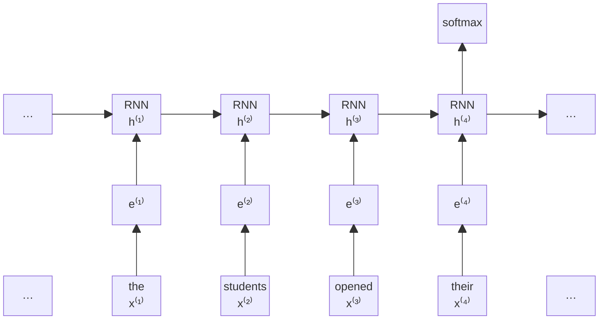
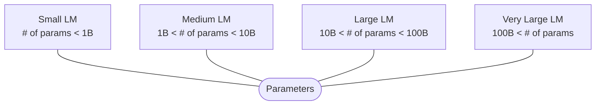
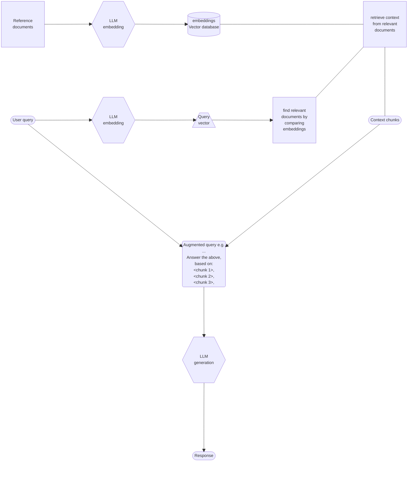

In generale, il compito di NLP è quello di predirre quale sarà la prossima parola in una sequenza di testo. 
In maniera più formale, dato un vocabolario di simboli $V$, il *language modeling* impara una distribuzione di probabilità $P\left(w_1, \ldots, w_m\right)=\prod_{i=1}^m P\left(w_i \mid w_1, \ldots, w_{i-1}\right)$ su tutte le sequenze di parole $V$, questa probabilità $P$ è chiamata *language model*

Il language modeling può essere visto come un problema many-to-one dato che prende una sequenza di input e da un token in output, ma concettualmente può essere visto come un many-to-many dato che verrà eseguito ripetutamente fino ad una condizione di terminazione. 

![[Frame 11 figura.png]]



Ogni blocco *RNN* può essere qualsiasi architettura RNN, principalmente è il modello transformer .
Qualsiasi $x^{(t)}$ è una rappresentazione vettoriale della sequenza di parole, l'output finale è un softmax su $|V|$ valori.

---
Il transformer è considerato oggi giorno come l'architettura di riferimento in molti domini NLP, ma è applicato anche in molti altri campi in cui c'è il bisogno di analizzare sequenze.

# LLM (Large language models)

Gli LLM fanno riferimento a modelli di linguaggio che sono allenati con un numero molto grande di parametri, anche miliardi. Di solito un numero più grande di parametri aumenta la qualità dell'LLM.



![[Pasted image 20241221123021.png]]

# Fine tuning, Context learning e RAG 

Di solito gli LLM vengono addestrati su una quantità enorme di testo per essere "generalisti", e poi tramite fine-tuning si settorializza l'LLM per adattarlo allo scopo necessario. 

Si prende un dataset di esempi della task da risolvere e viene effettuato un nuovo "addestramento" partendo dall'LLM iniziale già addestrato. 

---
In context prompting/learning è un altro metodo per specializzare un LLM, dove viene data la descrizione del comportamento dell'LLM all'interno della stringa in input, questo non modifica i parametri come fa il fine tuning, ma fa affidamento completamente ai parametri iniziali del modello.

Questa stringa di istruzione è detta "prompt", che può anche contenere degli esempi di come dovrebbe essere il risultato, in questo caso vengono chiamati:
- Zero shot, se non ci sono esempi, solo la descrizione
- One shot, c'è un solo esempio
- Few-shot, se ci sono più di 1, di solito 10

Zero-shot prompt:

```text
Classifying the sentiment of a text consists of assessing the tone of the opinion expressed in the given text as
positive, negative, or neutral.
Text: I think the vacation was okay. Sentiment:
```

One-shot prompt:

```text
Classifying the sentiment of a text consists of assessing the tone of the opinion expressed in the given text as
positive, negative, or neutral.
Text: The product is terrible. Sentiment: Negative.
Text: I think the vacation was okay. Sentiment:
```

Few-shot prompt:

```text
Classifying the sentiment of a text consists of assessing the tone of the opinion expressed in the given text as
positive, negative, or neutral.
Text: The product is terrible. Sentiment: Negative.
Text: Super helpful, worth it Sentiment: Positive.
Text: I think the vacation was okay. Sentiment: Neutral.
Text: It doesnt work! Sentiment:
```

---
Un problema degli LLM è che è limitato alla "conoscenza" presente nel testo che è stato fornito durante il training. Se chiediamo qualcosa che LLM non ha mai visto, non sarà capace di trattarla. 
Per questo motivo si usa la RAG (retrival augmented generation) dove, data una domanda o messaggio, rappresentante il "task" da effettuare, vengono estratti documenti rilevanti da una base di conoscenza.

Mischiato alle istruzioni del prompt ed eventuali esempi, si riesce ad aumentare la qualità della risposta dell'LLM.



# Generative AI

La _Generative AI_ (GenAI) è una branca dell'intelligenza artificiale che crea contenuti digitali, come testo, immagini, video e musica. Sebbene spesso utilizzi modelli linguistici di grandi dimensioni (_LLM_, come ChatGPT), non si limita a questi. Il principio chiave è generalizzare i concetti degli LLM per lavorare con simboli diversi dai semplici elementi testuali, ad esempio unità di immagini, video o musica. L'avanzamento degli LLM ha portato a un boom della GenAI nei primi anni 2020, con applicazioni come chatbot (ChatGPT), sistemi testo-immagine (DALL-E) e testo-video (Sora).
