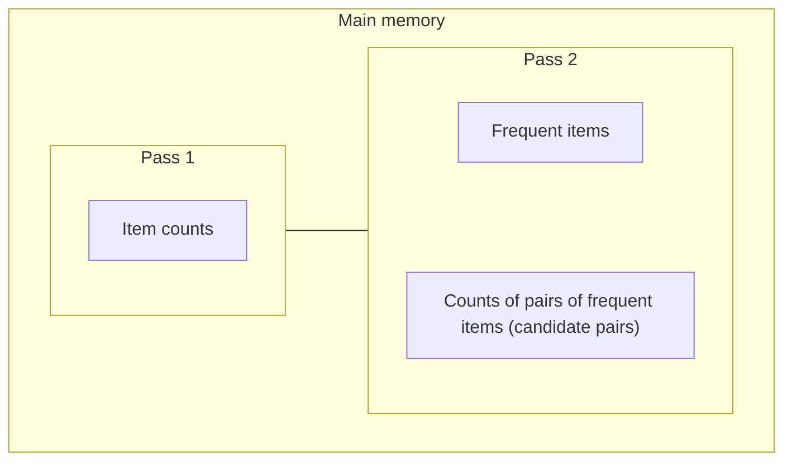
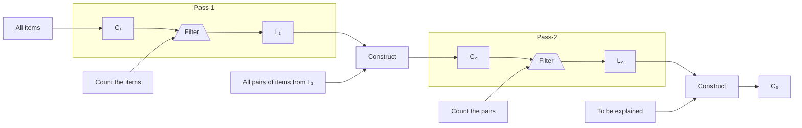
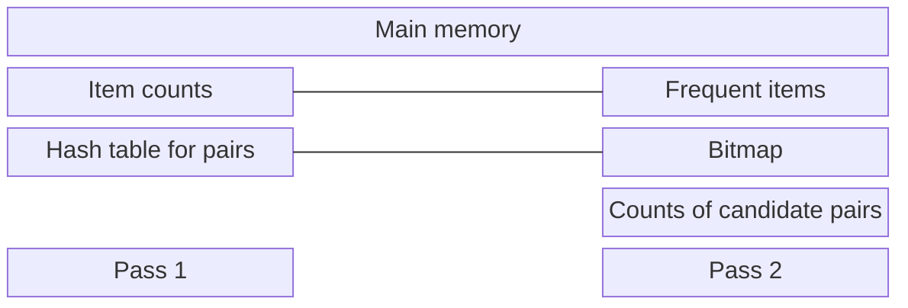
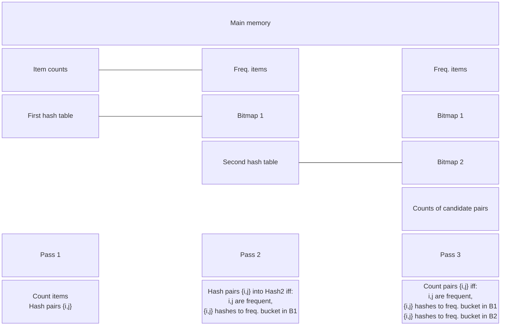

Association mining is the problem of finding a mapping between many to many kinds of things

# Frequent itemsets
We want to find a set of items that appear together frequently in baskets. We have a defined *support* threshold which we use to determine when items are to be considered. The sets of items that appear in at least *s* baskets are called *frequent itemsets* 

- **Items** = {milk, coke, pepsi, beer, juice}
- **Support threshold** = 3 baskets

$B_1 = \{m, c, b\}$  
$B_2 = \{m, p, j\}$  
$B_3 = \{m, b\}$  
$B_4 = \{c, j\}$  
$B_5 = \{m, p, b\}$  
$B_6 = \{m, c, b, j\}$  
$B_7 = \{c, b, j\}$  
$B_8 = \{b, c\}$

- **Frequent itemsets**: {m}, {c}, {b}, {j}, {m,b}, {b,c}, {c,j}.

# Association rules
they are if-then rules about the contents of baskets
${i_1, i_2, ..., i_k} \rightarrow j$, this means "if a basket contains all of $i_1, ..., i_k$ then it is likely to contain $j$".
The **Confidence** of this association rule is the probability of $j$ given $I={i_1, ..., i_k}$, defined as:
$$
conf(I \rightarrow J) = \dfrac{support(I \cup j)}{support(I)}
$$
Not all high confidence rules are interesting. let's take an item that is very often bought, let's call this *FreqItem*, then $X \rightarrow FreqItem$ is not very useful because the confidence will be high regardless of what $X$ is

The **Interest** of an association rule $I \rightarrow j$ is the absolute difference between its confidence and the probability $P_r(j)$ that a basket contains $j$
$$
Interest(I \rightarrow j) = |conf(I \rightarrow j) - P_r(j)|
$$
We could call a rule interesting if they have high interest values (usually above 0.5)

$B_1 = \{m, c, b\}$  
$B_2 = \{m, p, j\}$  
$B_3 = \{m, b\}$  
$B_4 = \{c, j\}$  
$B_5 = \{m, p, b\}$  
$B_6 = \{m, c, b, j\}$  
$B_7 = \{c, b, j\}$  
$B_8 = \{b, c\}$

- **Association rule**: $\{m, b\} \to c$
  - *Confidence* = $2/4 = 0.5$
  - *Interest* = $\lvert 0.5 - 5/8 \rvert = 1/8 = 0{,}125$
    - Item $c$ appears in $5/8$ of the baskets
    - Rule is not very interesting!

## Finding association rules
We want to find all association rules with $support \geq s$ and $confidence \geq c$ 
If $\{i_1, i_2, ..., i_k\} \rightarrow j$ has high support and confidence, then both $\{i_1, i_2, ..., i_k\}$ and $\{i_1, i_2, ..., i_k, j\}$ will be "frequent"
$$
conf(I \rightarrow j) = \dfrac{support(I \cup j)}{support(I)}
$$

We find all frequent itemsets $I$, then for  every subset $A$ of $I$, generate the rule $A \rightarrow I \backslash A$.
Since $I$ is frequent, $A$ is also frequent

**(variant 1)**: Single pass to compute the rule confidence:
$$
confidence(A,B \rightarrow C,D) = support(A,B,C,D)
$$
**(variant 2)**: we know that if $A,B,C \rightarrow D$ is below confidence, then $A,B \rightarrow C,D$ is also below confidence. This means we can generate bigger rules from smaller ones

$B_1 = \{m, c, b\}$  
$B_2 = \{m, p, j\}$  
$B_3 = \{m, c, b, n\}$  
$B_4 = \{c, j\}$  
$B_5 = \{m, p, b\}$  
$B_6 = \{m, c, b, j\}$  
$B_7 = \{c, b, j\}$  
$B_8 = \{b, c\}$

- **Support threshold** $s = 3$, **confidence** $c = 0.75$
- **1) Frequent itemsets**:
  - {b,m} {b,c} {c,m} {c,j} {m,c,b}
- **2) Generate rules**:

| | | |
|---|---|---|
| $b \to m$: $c=4/6$ | $b \to c$: $c=5/6$ | $b,c \to m$: $c=3/5$ |
| $m \to b$: $c=4/5$ | … | $b,m \to c$: $c=3/4$ |
| | | $b \to c,m$: $c=3/6$ |

![[Pasted image 20231211113617.png]]Given $d$ items, there are a total of $2^d$ possible itemsets

We can reduce the number of rules by post processing them and output only:
- **Maximal Frequent Itemset**: A frequent item set X is maximal if the $SupportLevel > MinSupport$, and no superset of it is frequent. (we get the set of items which is the largest set that we can get without dropping below the $MinSupport$ threshold, as in, any element that we add to this set will make it drop below the $MinSupport$)
- **Closed item sets**: An itemset $X$ is closed if none of it's supersets have the exact same support as $X$. (adding any item to this item set will reduce it's support)

## Computation issues with finding frequent itemsets
To be able to compute the frequent itemsets we need to be able to read the whole items, this means having a way to read all the different items in the set. In large datasets this information is stored in disk, and the majority of time of the computation will be in disk I/O
We can think of items being part of baskets, where baskets are files in disk

The hardest problem is finding frequent *pairs* of items $\{i_1, i_2\}$, as it's the most likely. the probability of items to be frequent drops exponentially with the size of the set.

# Naive algorithm
A naive approach to find frequent pairs is to read the file once, counting in main memory the occurrences of each pair. From each "basket" of $n$ items, generate it's $n(n-1)/2$ pairs by using two nested loops. This approach fails if the $NumOfItems^2$ exceeds the main memory.
There are two approaches to this:
1) Count all pairs using a matrix, but this combinations between pairs (4 bytes, aka 1 number), this generates a triangular matrix, following the 2 loops
2) Keep a table of triples $[i,j,c]$ which means "the count of the pair items $\{i,j\}$ is c", but this is stored only if the $count > 0$ (12 bytes, 1 number and 2 Ids)

With the first approach, the total number of pairs is $\approx 2n^2$, the second approach is better only if less than 1/3rd of the possible pairs occur

# A-Priori Algorithm
Instead of doing a single pass, we use a two pass approach that uses the idea of *monotonicity*. Monotonicity applies because if a set of itemset $I$ appears at least $s$ times, so does every subset $J$ of $I$. And for pairs, if item $i$ does not appear in $s$ baskets, then no pair including $i$ can appear in $s$ baskets
As mentioned the algorithm works in two passes
1) Read baskets and count in main memory the occurrences of each item. Items that $appear \geq s$ times are *frequent items*
2) Read the baskets again and count in main memory only the pairs where both elements are considered *frequent* from pass 1
This approach uses as much memory as the square of frequent items plus a list of the frequent items



When dealing with frequent triples or higher, let's say $k-tuples$ (a set of size $k$), we then define:
- $C_k$ as the candidate $k-tuples$ whose support might be $\geq s$ based off the $k-1$ pass.
- $L_k$ as the set of truly frequent $k-tuples$



# PCY (Park-Chen-Yu) Algorithm
We observe that in the first pass of the $A-Priori$ algorithm, most memory is idle.

The PCY algorithm uses the intuition that:

>instead of getting the counts of each item in the dataset, we counted the number of items that started with each letter of the alphabet.
>If the number of items that started with the letter _‘a’_ was less than our support threshold, we would know that none of the items that start with the letter _‘a’_ are frequent. For example, if _apples_ had been frequent, then the count of items starting with _‘a’_ would have been above our threshold.

The PCY algorithm uses the unused memory to store a hashtable with as many buckets as fit in the unused memory, and in this hashtable, it stores the count of the hash of every combination of items inside of the basket, and increments it by 1 if it already exists. Once finished with this first step, we know that all the hashed pairs in the hashtable which are below the support must not be frequent, else the items would have hashed to those buckets, so we know that any pair that hashes to a bucket with support lower than $s$ is surely not a frequent pair. [link to explaination](https://medium.com/weekly-data-science/the-pcy-algorithm-and-its-friends-ecba67216190) 

```text
FOR (each basket) :
    FOR (each item in the basket) :
        add 1 to item's count;
    FOR (each pair of items) :        // New in PCY
        hash the pair to a bucket;    // New in PCY
        add 1 to the count for that bucket;    // New in PCY
```

this means that we can eliminate all candidates of items that hash to buckets which are below the support.

In the second pass of the algorithm, we count only pairs that hash to frequent buckets. We could simplify this hashmap by changing it from storing buckets of integers, to storing a bucket of bits, with value 1 if the bucket is frequent, and value 0 if the bucket is not frequent



In general the condition for an element to be considered frequent, is that in a pair: 
1) both ${i, j}$ are frequent
2) the pair $\{i,j\}$ hashes to a frequent bucket 

# Multi stage algorithm 
This is a refinement of the PCY algorithm, in cases where memory is still a bottleneck, we can do 3 passes over the data. the first step is the same as the PCY algorithm, the second step, we rehash only the values that qualify for pass 2 of PCY (so that $i, j$ are frequent and the bucket $\{i,j\}$ is frequent)



And in this case, a pair is considered frequent if:
1) both $i, j$ are frequent items
2) Using the first hash function, the pair $\{i,j\}$ hashes to a frequent bucket
3) Using the second hash function, the pair $\{i,j\}$ hashes to a frequent bucket

It is important that the two hashing functions are independent from each other

# Multi hash
We can also use multiple hashing functions in multiple hashing tables in the first stage, the problem with this approach is that every time we increase the number of hashing steps, we lower the amount of buckets, increasing the average count of a pair being in a bucket

# SON algorithm
This is especially useful in distributed dataset scenario, and the dataset is impossible to be stored on a single  machine. 
1) Each machine gets a partition of the data that it can fit in memory
2) Each machine applies one of the frequent itemset mining algorithms independently to each partition. The support is the same between each machine
3) Combine all the frequent item sets from all partitions to generate a set of candidate global frequent itemsets 
4) Verify the global frequent itemsets in the entire dataset to determine the truly frequent itemsets
