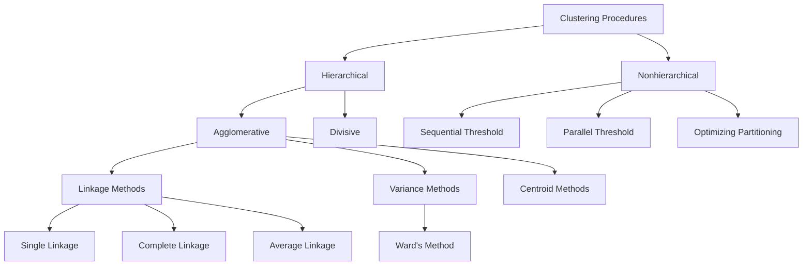
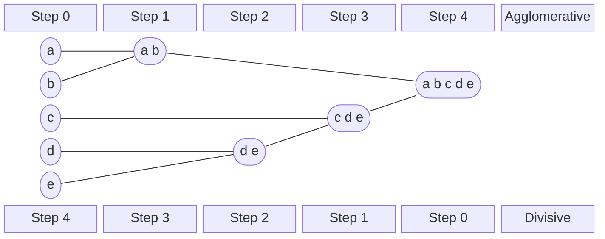
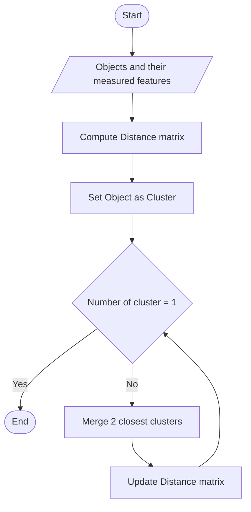

 The purpose of clustering analysis is to find groups of objects which are related to each other. The definition of a cluster can be ambiguous, as we need to define what we consider a cluster.

# Types of clustering
There are two kinds of clustering:
1) **Partitional clustering**, it's the division of data into non overlapping clusters, so that a single data object is only in one subset
2) **Hierarchical clustering**, the set of nested clusters which are organized in a hierarchical tree



we can then also specialize the clusters into:
- Well-centered clusters
- Center-based clusters
- Contiguous clusters
- Density-based clusters
- Property or Conceptual
- Described by an objective function

## Well-Separated cluster
In the Well-separated cluster, a cluster is a set of points such that any point in cluster is closer (or more similar) to every other point in the cluster, than to any other point not in the cluster

```plot
x: [0, 8]
y: [0, 3.3]
width: 480
height: 200
axes: false
items:
  - point: [3.8, 2.3]
    size: 36
    color: red
  - point: [2, 0.8]
    size: 36
    color: blue
  - point: [6, 0.8]
    size: 36
    color: green
```

## Center-based cluster
In the center-based cluster, a cluster is a set of objects such that an object in a cluster is closer (or more similar) to the "center" of it's cluster, than it is to the center of any other cluster. The center of the cluster is called **centroid** and it is the average of all points in the cluster, or alternatively, we use the *medoid* which is the point that is most "representative" of the cluster

```plot
x: [0, 8]
y: [0, 2.4]
width: 480
height: 150
axes: false
items:
  - point: [1.6, 1.2]
    size: 30
    color: red
  - point: [2.8, 1.2]
    size: 30
    color: blue
  - point: [5.15, 1.2]
    size: 26
    color: green
  - point: [6.35, 1.2]
    size: 26
    color: orange
```

## Contiguity-based cluster
In the contiguity-based cluster, a cluster is a set of points such that a point in a cluster is closer (or more similar) to one or more points in the cluster than to any other point not in the cluster
![[Pasted image 20231213154355.png]]

## Density-based clusters
In density-based clusters, a cluster is a dense region of points, which are separated by low density regions, and then again higher density regions. It is mostly used when clusters are irregular and intertwined, and when noise and outliers are present

```plot
x: [0, 743]
y: [0, 142]
width: 520
aspect: equal
axes: false
items:
  - line: [[176.2, 101.2], [167.0, 104.8], [156.8, 107.7], [146.0, 109.9], [134.6, 111.4], [122.9, 112.0], [111.2, 111.8], [99.7, 110.8], [88.5, 108.9], [78.0, 106.4], [68.3, 103.1], [59.6, 99.2], [52.0, 94.7], [45.8, 89.7], [41.1, 84.4], [37.8, 78.7], [36.2, 72.9], [36.2, 67.1], [37.8, 61.3], [41.1, 55.6], [45.8, 50.3], [52.0, 45.3], [59.6, 40.8], [68.3, 36.9], [78.0, 33.6], [88.5, 31.1], [99.7, 29.2], [111.2, 28.2], [122.9, 28.0], [134.6, 28.6], [146.0, 30.1], [156.8, 32.3], [167.0, 35.2], [176.2, 38.8]]
    color: blue
    width: 22
  - point: [116, 69]
    size: 9
    color: purple
  - point: [181, 69]
    size: 9
    color: teal
  - circle: [306, 79]
    r: 44
    color: blue
    fill: true
  - circle: [386, 79]
    r: 44
    color: blue
    fill: true
  - circle: [543, 70]
    r: 36
    color: green
    fill: true
  - circle: [630, 70]
    r: 37
    color: orange
    fill: true
```

## Conceptual clusters
In conceptual clusters, a cluster is a set of objects that share a common propriety or particular concept (sub-space)

```plot
x: [0, 742]
y: [0, 225]
width: 480
aspect: equal
axes: false
items:
  - circle: [309, 113]
    rx: 86
    ry: 76
    color: red
    width: 14
  - circle: [403, 113]
    rx: 86
    ry: 76
    color: red
    width: 14
```

# Hierarchical clustering
This is a typical clustering analysis approach which partitions data set sequentially. It constructs nested partitions layer by layer via grouping objects in a tree of clusters.

There are two approaches when building hierarchical clusters:
- **Agglomerative**, a bottom up strategy where initially, each data object is it's own atomic cluster, then we merge those clusters into larger and larger clusters
- **Divisive**, is a top down strategy where initially, all objects are in a single cluster, and we try to subdivide them into smaller and smaller clusters



There are also different methods to compare the distance between clusters:
- **Single link**: the smallest distance between an element in one cluster and an element in another cluster. $d(C_i, C_j) = min\{d(x_{ip}, x_{jp})\}$ 
- **Complete link**: the largest distance between an element in one cluster and an element in another cluster. $d(C_i, C_j) = max\{d(x_{ip}, x_{jp})\}$
- **Average**: the average distance between elements in one cluster and elements in another. $d(C_i, C_j) = avg\{d(x_{ip}, x_{jp})\}$ 
![[Pasted image 20231213155533.png]]

**Example**: Given a data set of five objects characterized by a single continuous feature, assume that there are two clusters: C1: {a, b} and C2: {c, d, e}.

| | a | b | c | d | e |
|---|---|---|---|---|---|
| Feature | 1 | 2 | 4 | 5 | 6 |

1. Calculate the distance matrix;
2. Calculate three cluster distances between C1 and C2.

| | a | b | c | d | e |
|---|---|---|---|---|---|
| **a** | 0 | 1 | 3 | 4 | 5 |
| **b** | 1 | 0 | 2 | 3 | 4 |
| **c** | 3 | 2 | 0 | 1 | 2 |
| **d** | 4 | 3 | 1 | 0 | 1 |
| **e** | 5 | 4 | 2 | 1 | 0 |

*Single link*

$$
\begin{aligned}
\mathrm{dist}(C_1,C_2) &= \min\{d(a,c), d(a,d), d(a,e), d(b,c), d(b,d), d(b,e)\} \\
&= \min\{3, 4, 5, 2, 3, 4\} = 2
\end{aligned}
$$

*Complete link*

$$
\begin{aligned}
\mathrm{dist}(C_1,C_2) &= \max\{d(a,c), d(a,d), d(a,e), d(b,c), d(b,d), d(b,e)\} \\
&= \max\{3, 4, 5, 2, 3, 4\} = 5
\end{aligned}
$$

*Average*

$$
\begin{aligned}
\mathrm{dist}(C_1,C_2) &= \frac{d(a,c) + d(a,d) + d(a,e) + d(b,c) + d(b,d) + d(b,e)}{6} \\
&= \frac{3+4+5+2+3+4}{6} = \frac{21}{6} = 3.5
\end{aligned}
$$

# Agglomerative Algorithm

1) Convert all object features into a distance matrix
2) Set each object as a cluster (thus if we have *N* objects, we will have *N* clusters at the beginning)
3) Repeat until number of cluster is one (or known # of clusters)
    - Merge two closest clusters
    - Update "distance matrix"



## Agglomerative algorithm example:

**Problem: clustering analysis with agglomerative algorithm**

```plot
x: [0, 6.5]
y: [0, 6.5]
width: 380
height: 300
xticks: [0, 2, 4, 6]
yticks: [0, 1, 2, 3, 4, 5, 6]
xlabel: $X1$
ylabel: $X2$
items:
  - point: [1, 1]
    label: A
    anchor: e
  - point: [1.5, 1.5]
    label: B
    anchor: e
  - point: [5, 5]
    label: C
    anchor: e
  - point: [3, 4]
    label: D
    anchor: e
  - point: [4, 4]
    label: E
    anchor: e
  - point: [3, 3.5]
    label: F
    anchor: e
```

Data matrix

| | X1 | X2 |
|---|---|---|
| A | 1 | 1 |
| B | 1.5 | 1.5 |
| C | 5 | 5 |
| D | 3 | 4 |
| E | 4 | 4 |
| F | 3 | 3.5 |

Euclidean distance

$$d_{AB} = \left((1-1.5)^2 + (1-1.5)^2\right)^{\frac{1}{2}} = \sqrt{\tfrac{1}{2}} = 0.7071$$

$$d_{DF} = \left((3-3)^2 + (4-3.5)^2\right)^{\frac{1}{2}} = 0.5$$

Distance matrix

| Dist | A | B | C | D | E | F |
|---|---|---|---|---|---|---|
| A | 0.00 | 0.71 | 5.66 | 3.61 | 4.24 | 3.20 |
| B | 0.71 | 0.00 | 4.95 | 2.92 | 3.54 | 2.50 |
| C | 5.66 | 4.95 | 0.00 | 2.24 | 1.41 | 2.50 |
| D | 3.61 | 2.92 | 2.24 | 0.00 | 1.00 | 0.50 |
| E | 4.24 | 3.54 | 1.41 | 1.00 | 0.00 | 1.12 |
| F | 3.20 | 2.50 | 2.50 | **0.50** | 1.12 | 0.00 |

(Iteration 1) Merge two closest clusters

```plot
x: [0, 6.5]
y: [0, 6.5]
width: 380
height: 300
xticks: [0, 2, 4, 6]
yticks: [0, 1, 2, 3, 4, 5, 6]
xlabel: $X1$
ylabel: $X2$
items:
  - point: [1, 1]
    label: A
    anchor: e
  - point: [1.5, 1.5]
    label: B
    anchor: e
  - point: [5, 5]
    label: C
    anchor: e
  - point: [3, 4]
    label: D
    anchor: e
  - point: [4, 4]
    label: E
    anchor: e
  - point: [3, 3.5]
    label: F
    anchor: e
  - circle: [3, 3.75]
    rx: 0.3
    ry: 0.75
    color: red
```

| Dist | A | B | C | D | E | F |
|---|---|---|---|---|---|---|
| A | 0.00 | 0.71 | 5.66 | 3.61 | 4.24 | 3.20 |
| B | 0.71 | 0.00 | 4.95 | 2.92 | 3.54 | 2.50 |
| C | 5.66 | 4.95 | 0.00 | 2.24 | 1.41 | 2.50 |
| D | 3.61 | 2.92 | 2.24 | 0.00 | 1.00 | 0.50 |
| E | 4.24 | 3.54 | 1.41 | 1.00 | 0.00 | 1.12 |
| F | 3.20 | 2.50 | 2.50 | **0.50** | 1.12 | 0.00 |

| Dist | A | B | C | D, F | E |
|---|---|---|---|---|---|
| A | 0.00 | 0.71 | 5.66 | ? | 4.24 |
| B | 0.71 | 0.00 | 4.95 | ? | 3.54 |
| C | 5.66 | 4.95 | 0.00 | ? | 1.41 |
| **D, F** | ? | ? | ? | 0.00 | ? |
| E | 4.24 | 3.54 | 1.41 | ? | 0.00 |

(Iteration 1) Update the distance matrix with the now merged D,F cluster

| Dist | A | B | C | D | E | F |
|---|---|---|---|---|---|---|
| A | 0.00 | 0.71 | 5.66 | 3.61 | 4.24 | 3.20 |
| B | 0.71 | 0.00 | 4.95 | 2.92 | 3.54 | 2.50 |
| C | 5.66 | 4.95 | 0.00 | 2.24 | 1.41 | 2.50 |
| D | 3.61 | 2.92 | 2.24 | 0.00 | 1.00 | 0.50 |
| E | 4.24 | 3.54 | 1.41 | 1.00 | 0.00 | 1.12 |
| F | 3.20 | 2.50 | 2.50 | **0.50** | 1.12 | 0.00 |

| Dist | A | B | C | D, F | E |
|---|---|---|---|---|---|
| A | 0.00 | 0.71 | 5.66 | ? | 4.24 |
| B | 0.71 | 0.00 | 4.95 | ? | 3.54 |
| C | 5.66 | 4.95 | 0.00 | ? | 1.41 |
| D, F | ? | ? | ? | 0.00 | ? |
| E | 4.24 | 3.54 | 1.41 | ? | 0.00 |

$$d_{(D,F)\to A} = \min(d_{DA}, d_{FA}) = \min(3.61, 3.20) = 3.20$$

$$d_{(D,F)\to B} = \min(d_{DB}, d_{FB}) = \min(2.92, 2.50) = 2.50$$

$$d_{(D,F)\to C} = \min(d_{DC}, d_{FC}) = \min(2.24, 2.50) = 2.24$$

$$d_{E\to(D,F)} = \min(d_{ED}, d_{EF}) = \min(1.00, 1.12) = 1.00$$

**Min Distance (Single Linkage)**

| Dist | A | B | C | D, F | E |
|---|---|---|---|---|---|
| A | 0.00 | 0.71 | 5.66 | **3.20** | 4.24 |
| B | 0.71 | 0.00 | 4.95 | **2.50** | 3.54 |
| C | 5.66 | 4.95 | 0.00 | **2.24** | 1.41 |
| D, F | **3.20** | **2.50** | **2.24** | 0.00 | **1.00** |
| E | 4.24 | 3.54 | 1.41 | **1.00** | 0.00 |

(Iteration 2) Merge the two closest clusters

```plot
x: [0, 6.5]
y: [0, 6.5]
width: 380
height: 300
xticks: [0, 2, 4, 6]
yticks: [0, 1, 2, 3, 4, 5, 6]
xlabel: $X1$
ylabel: $X2$
items:
  - point: [1, 1]
    label: A
    anchor: e
  - point: [1.5, 1.5]
    label: B
    anchor: e
  - point: [5, 5]
    label: C
    anchor: e
  - point: [3, 4]
    label: D
    anchor: e
  - point: [4, 4]
    label: E
    anchor: e
  - point: [3, 3.5]
    label: F
    anchor: e
  - circle: [3, 3.75]
    rx: 0.3
    ry: 0.75
    color: red
  - circle: [1.25, 1.25]
    rx: 0.75
    ry: 0.7
    color: red
```

**Min Distance (Single Linkage)**

| Dist | A | B | C | D, F | E |
|---|---|---|---|---|---|
| A | 0.00 | 0.71 | 5.66 | 3.20 | 4.24 |
| **B** | **0.71** | 0.00 | 4.95 | 2.50 | 3.54 |
| C | 5.66 | 4.95 | 0.00 | 2.24 | 1.41 |
| D, F | **3.20** | **2.50** | **2.24** | 0.00 | 1.00 |
| E | 4.24 | 3.54 | 1.41 | **1.00** | 0.00 |

| Dist | A,B | C | (D, F) | E |
|---|---|---|---|---|
| **A,B** | 0 | ? | ? | ? |
| C | ? | 0 | 2.24 | 1.41 |
| (D, F) | ? | 2.24 | 0 | 1.00 |
| E | ? | 1.41 | 1.00 | 0 |

(Iteration 2) Update the distance matrix 

**Min Distance (Single Linkage)**

| Dist | A | B | C | D, F | E |
|---|---|---|---|---|---|
| A | 0.00 | 0.71 | 5.66 | 3.20 | 4.24 |
| B | **0.71** | 0.00 | 4.95 | 2.50 | 3.54 |
| C | 5.66 | 4.95 | 0.00 | 2.24 | 1.41 |
| D, F | **3.20** | **2.50** | **2.24** | 0.00 | 1.00 |
| E | 4.24 | 3.54 | 1.41 | **1.00** | 0.00 |

| Dist | A,B | C | (D, F) | E |
|---|---|---|---|---|
| A,B | 0 | ? | ? | ? |
| C | ? | 0 | 2.24 | 1.41 |
| (D, F) | ? | 2.24 | 0 | 1.00 |
| E | ? | 1.41 | 1.00 | 0 |

$$d_{C\to(A,B)} = \min(d_{CA}, d_{CB}) = \min(5.66, 4.95) = 4.95$$

$$
\begin{aligned}
d_{(D,F)\to(A,B)} &= \min(d_{DA}, d_{DB}, d_{FA}, d_{FB}) \\
&= \min(3.61, 2.92, 3.20, 2.50) = 2.50
\end{aligned}
$$

$$d_{E\to(A,B)} = \min(d_{EA}, d_{EB}) = \min(4.24, 3.54) = 3.54$$

**Min Distance (Single Linkage)**

| Dist | A,B | C | (D, F) | E |
|---|---|---|---|---|
| A,B | 0 | **4.95** | **2.50** | **3.54** |
| C | **4.95** | 0 | 2.24 | 1.41 |
| (D, F) | **2.50** | 2.24 | 0 | 1.00 |
| E | **3.54** | 1.41 | 1.00 | 0 |

(Iteration 3) Merge two closest clusters and update distance matrix

```plot
x: [0, 6.5]
y: [0, 6.5]
width: 380
height: 300
xticks: [0, 2, 4, 6]
yticks: [0, 1, 2, 3, 4, 5, 6]
xlabel: $X1$
ylabel: $X2$
items:
  - point: [1, 1]
    label: A
    anchor: e
  - point: [1.5, 1.5]
    label: B
    anchor: e
  - point: [5, 5]
    label: C
    anchor: e
  - point: [3, 4]
    label: D
    anchor: e
  - point: [4, 4]
    label: E
    anchor: e
  - point: [3, 3.5]
    label: F
    anchor: e
  - circle: [3, 3.75]
    rx: 0.3
    ry: 0.75
    color: red
  - circle: [1.25, 1.25]
    rx: 0.75
    ry: 0.7
    color: red
  - circle: [3.5, 3.9]
    rx: 1
    ry: 0.7
    color: red
```

**Min Distance (Single Linkage)**

| Dist | (A,B) | C | (D, F) | E |
|---|---|---|---|---|
| (A,B) | 0 | 4.95 | 2.50 | 3.54 |
| C | **4.95** | 0 | 2.24 | 1.41 |
| (D, F) | **2.50** | 2.24 | 0 | **1.00** |
| E | **3.54** | 1.41 | **1.00** | 0 |

**Min Distance (Single Linkage)**

| Dist | (A,B) | C | (D, F), E |
|---|---|---|---|
| (A,B) | 0.00 | 4.95 | 2.50 |
| C | 4.95 | 0.00 | 1.41 |
| (D, F), E | **2.50** | 1.41 | 0.00 |

(Iteration 4) Merge two clusters and update distance matrix

```plot
x: [0, 6.5]
y: [0, 6.5]
width: 380
height: 300
xticks: [0, 2, 4, 6]
yticks: [0, 1, 2, 3, 4, 5, 6]
xlabel: $X1$
ylabel: $X2$
items:
  - point: [1, 1]
    label: A
    anchor: e
  - point: [1.5, 1.5]
    label: B
    anchor: e
  - point: [5, 5]
    label: C
    anchor: e
  - point: [3, 4]
    label: D
    anchor: e
  - point: [4, 4]
    label: E
    anchor: e
  - point: [3, 3.5]
    label: F
    anchor: e
  - circle: [3, 3.75]
    rx: 0.3
    ry: 0.75
    color: red
  - circle: [1.25, 1.25]
    rx: 0.75
    ry: 0.7
    color: red
  - circle: [3.5, 3.9]
    rx: 1
    ry: 0.7
    color: red
  - circle: [3.9, 4.3]
    rx: 1.95
    ry: 1.2
    color: red
```

**Min Distance (Single Linkage)**

| Dist | (A,B) | C | (D, F), E |
|---|---|---|---|
| (A,B) | 0.00 | 4.95 | 2.50 |
| C | 4.95 | 0.00 | 1.41 |
| (D, F), E | **2.50** | **1.41** | 0.00 |

**Min Distance (Single Linkage)**

| Dist | (A,B) | ((D, F), E),C |
|---|---|---|
| (A,B) | 0.00 | **2.50** |
| ((D, F), E),C | **2.50** | 0.00 |

(Iteration 5) Final iteration, merge the last two clusters, termination condition
We construct the **Dendrogram tree** of the cluster

```plot
x: [0.2, 6.8]
y: [0, 2.8]
width: 460
height: 300
ylabel: lifetime
yticks: [0.5, 1.0, 1.5, 2.0, 2.5]
xticks: { 1: "D", 2: "F", 3: "E", 4: "C", 5: "A", 6: "B" }
items:
  - line: [[1, 0], [1, 0.5], [2, 0.5], [2, 0]]
    color: green
  - line: [[1.5, 0.5], [1.5, 1.0], [3, 1.0], [3, 0]]
    color: green
  - line: [[2.25, 1.0], [2.25, 1.41], [4, 1.41], [4, 0]]
    color: green
  - line: [[5, 0], [5, 0.71], [6, 0.71], [6, 0]]
    color: green
  - line: [[3.125, 1.41], [3.125, 2.5], [5.5, 2.5], [5.5, 0.71]]
    color: green
  - text: "2"
    at: [1.5, 0.4]
  - text: "4"
    at: [2.25, 0.9]
  - text: "5"
    at: [3.125, 1.31]
  - text: "3"
    at: [5.5, 0.61]
  - text: "6"
    at: [4.3, 2.4]
```

1. In the beginning we have 6 clusters: A, B, C, D, E and F
2. We merge clusters D and F into cluster (D, F) at distance 0.50
3. We merge cluster A and cluster B into (A, B) at distance 0.71
4. We merge clusters E and (D, F) into ((D, F), E) at distance 1.00
5. We merge clusters ((D, F), E) and C into (((D, F), E), C) at distance 1.41
6. We merge clusters (((D, F), E), C) and (A, B) into ((((D, F), E), C), (A, B)) at distance 2.50
7. The last cluster contain all the objects, thus conclude the computation

- The **Lifetime** of a cluster, as the difference between the proximity level moment the cluster was created, and the proximity level of when it was merged with any of the other clusters.  
  Taking the example of before: the lifetime of A, B, C, D, E, F are: 0.71, 0.71, 1.41, 0.50, 1.00, 0.50, and the lifetime of (A,B) is $2.50 - 0.71 = 1.79$
- The **K-cluster lifetime** is the distance from that K clusters merge to that of K clusters vanish due to the reduction to k-1 clusters

# K-Mean clustering
[link to demo](https://user.ceng.metu.edu.tr/~akifakkus/courses/ceng574/k-means/)
Given a $K$, find a partition of $K$ clusters to optimize the chosen partition criterion, in respect to a cost function. The $K$-means algorithm is a heuristic method where each cluster is represented by the center of the cluster and the algorithm converges to stable centroids of clusters. It is the simplest and most used clustering analysis algorithm. It works by:

0) Set centroids points randomly  
1) Assign each object to the cluster of the nearest seed point measured with a specific distance metric
2) Compute new centroids points of the current partition 
3) GOTO step 1, stop when there is no more new assignment, so each clusters does not change
This algorithm has a computational complexity of $O(tKn)$ where n is the number of objects, K is the number of clusters, and t is the number of iterations

The problem with this algorithm is that it is sensitive to the initial seed points, and could fall into an unwanted local optimum. It also has the drawback of having to specify the number of clusters $K$ in advance, it can't handle (properly) noisy data and it is not suitable for clustering with non convex shapes. It is applicable only when the centroids are "definable"

## Choosing the initial centroids
The chance of selecting one centroid from each cluster is really small, considering clusters of the same size then the probability of this is:
$$
P = \dfrac{\#ways \, to \, select \, one \,centroid \, from \,each \, cluster}{\#ways \, to \, select \, K \, centroids} = \dfrac{K!n^K}{(Kn)^K} = \dfrac{K!}{K^K}
$$
which even for K = 10, the probability is 0.00036. Sometimes the centroids will readjust themselves, other times they wont.

This is an example of a good first centroid choice
![[Pasted image 20231215152241.png]]
While this is a bad example for the first centroid 
![[Pasted image 20231215152329.png]]
There are ways to mitigate this, such as:
- Using multiple runs, but the probability is not that much higher
- Use hierarchical clustering to determine the initial centroids
- Select more than $K$ initial centroids and then select the most widely separated ones, and apply some post processing to merge clusters together 

## K-Means limitations

### Differing sizes
![[Pasted image 20231215153001.png]]
Can be solved by using more k-means clusters and then merging them
![[Pasted image 20231215153146.png]]

### Differing density
![[Pasted image 20231215153024.png]]
Can be solved by using more k-means clusters and merging them
![[Pasted image 20231215153249.png]]

### Non globular shapes
![[Pasted image 20231215153049.png]]
Can be solved by using more k-means clusters and merging them
![[Pasted image 20231215153304.png]]

## K-means example
Suppose we have 4 kinds of medicines, each has two attributes (PH and weight index), our goal is to group those objects into K=2 groups of medicines. We start off with this data set:

| Medicine | Weight | pH-Index |
| --- | --- | --- |
| A | 1 | 1 |
| B | 2 | 1 |
| C | 4 | 3 |
| D | 5 | 4 |

```plot
x: [0, 6]
y: [0, 4.5]
width: 420
height: 300
grid: true
xticks: [1, 2, 3, 4, 5, 6]
yticks: [0.5, 1, 1.5, 2, 2.5, 3, 3.5, 4, 4.5]
xlabel: "attribute 1 (X): weight index"
ylabel: "attribute 2 (Y): pH"
items:
  - point: [1, 1]
    shape: square
    label: A
    anchor: n
  - point: [2, 1]
    shape: square
    label: B
    anchor: n
  - point: [4, 3]
    shape: square
    label: C
    anchor: n
  - point: [5, 4]
    shape: square
    label: D
    anchor: n
```

1) Use initial seed points for partitioning 

**iteration 0**

```plot
x: [0, 6]
y: [0, 4.5]
width: 420
height: 300
grid: true
xticks: [1, 2, 3, 4, 5, 6]
yticks: [0.5, 1, 1.5, 2, 2.5, 3, 3.5, 4, 4.5]
xlabel: "attribute 1 (X): weight index"
ylabel: "attribute 2 (Y): pH"
items:
  - point: [1, 1]
    shape: square
    label: A
    anchor: n
  - point: [2, 1]
    shape: square
    label: B
    anchor: n
  - point: [4, 3]
    shape: square
    label: C
    anchor: n
  - point: [5, 4]
    shape: square
    label: D
    anchor: n
  - point: [1, 1]
    shape: plus
    color: red
    size: 8
  - point: [2, 1]
    shape: plus
    color: red
    size: 8
```

$c_1 = A, c_2 = B$

$$
D^0 = \begin{bmatrix} 0 & 1 & 3.61 & \textcolor{red}{5} \\ 1 & 0 & 2.83 & \textcolor{red}{4.24} \end{bmatrix}
\quad
\begin{aligned}
c_1 &= (1,1) \quad \textit{group-1} \\
c_2 &= (2,1) \quad \textit{group-2}
\end{aligned}
$$

*Euclidean distance*

$$
\begin{matrix} A & B & C & D \end{matrix}
$$

$$
\begin{bmatrix} 1 & 2 & 4 & 5 \\ 1 & 1 & 3 & 4 \end{bmatrix}
\begin{matrix} X \\ Y \end{matrix}
$$

$$
\begin{aligned}
d(D, c_1) &= \sqrt{(5-1)^2 + (4-1)^2} = 5 \\
d(D, c_2) &= \sqrt{(5-2)^2 + (4-1)^2} = 4.24
\end{aligned}
$$

Assign each object to the cluster with the nearest seed point

2) Compute new centroids based off the current partitions

**iteration 1**

```plot
x: [0, 6]
y: [0, 4.5]
width: 420
height: 300
grid: true
xticks: [1, 2, 3, 4, 5, 6]
yticks: [0.5, 1, 1.5, 2, 2.5, 3, 3.5, 4, 4.5]
xlabel: "attribute 1 (X): weight index"
ylabel: "attribute 2 (Y): pH"
items:
  - vline: 1.5
    color: purple
    width: 3
  - point: [1, 1]
    shape: square
  - point: [2, 1]
    shape: square
  - point: [4, 3]
    shape: square
  - point: [5, 4]
    shape: square
  - point: [1, 1]
    shape: plus
    color: red
    size: 8
  - point: [3.67, 2.67]
    shape: plus
    color: red
    size: 8
```

Knowing the members of each cluster, now we compute the new centroid of each group based on these new memberships.

$$
c_1 = (1,\ 1)
$$

$$
c_2 = \left(\dfrac{2+4+5}{3},\ \dfrac{1+3+4}{3}\right) = \left(\dfrac{11}{3},\ \dfrac{8}{3}\right)
$$

Now modify the new membership of items based off the new centroids 

**iteration 1**

```plot
x: [0, 6]
y: [0, 4.5]
width: 420
height: 300
grid: true
xticks: [1, 2, 3, 4, 5, 6]
yticks: [0.5, 1, 1.5, 2, 2.5, 3, 3.5, 4, 4.5]
xlabel: "attribute 1 (X): weight index"
ylabel: "attribute 2 (Y): pH"
items:
  - vline: 1.5
    color: purple
    width: 3
  - point: [1, 1]
    shape: square
    label: A
    anchor: nw
  - point: [2, 1]
    shape: square
    label: B
    anchor: ne
  - point: [4, 3]
    shape: square
    label: C
    anchor: ne
  - point: [5, 4]
    shape: square
    label: D
    anchor: s
  - point: [1, 1]
    shape: plus
    color: red
    size: 8
    label: "1"
    anchor: se
  - point: [3.67, 2.67]
    shape: plus
    color: red
    size: 8
    label: "2"
    anchor: sw
```

Compute the distance of all objects to the new centroids

$$
D^1 = \begin{bmatrix} 0 & 1 & 3.61 & 5 \\ 3.14 & 2.36 & 0.47 & 1.89 \end{bmatrix}
\quad
\begin{aligned}
c_1 &= (1,1) \quad \textit{group-1} \\
c_2 &= \left(\tfrac{11}{3}, \tfrac{8}{3}\right) \quad \textit{group-2}
\end{aligned}
$$

$$
\begin{matrix} A & B & C & D \end{matrix}
$$

$$
\begin{bmatrix} 1 & 2 & 4 & 5 \\ 1 & 1 & 3 & 4 \end{bmatrix}
\begin{matrix} X \\ Y \end{matrix}
$$

Assign the membership to objects

$C_1 = ?$ $\qquad$ $C_2 = ?$

3) Repeat the first two steps until its convergence 

**iteration 2**

```plot
x: [0, 6]
y: [0, 4.5]
width: 420
height: 300
grid: true
xticks: [1, 2, 3, 4, 5, 6]
yticks: [0.5, 1, 1.5, 2, 2.5, 3, 3.5, 4, 4.5]
xlabel: "attribute 1 (X): weight index"
ylabel: "attribute 2 (Y): pH"
items:
  - line: [[1.0, 4.2], [3.8, 0.4]]
    color: purple
    width: 3
  - point: [1, 1]
    shape: square
  - point: [2, 1]
    shape: square
  - point: [4, 3]
    shape: square
  - point: [5, 4]
    shape: square
  - point: [1.5, 1]
    shape: plus
    color: red
    size: 8
    label: "1"
    anchor: se
  - point: [4.5, 3.5]
    shape: plus
    color: red
    size: 8
    label: "2"
    anchor: se
```

Knowing the members of each cluster, now we compute the new centroid of each group based on these new memberships.

$$
c_1 = \left(\dfrac{1+2}{2},\ \dfrac{1+1}{2}\right) = \left(1\dfrac{1}{2},\ 1\right)
$$

$$
c_2 = \left(\dfrac{4+5}{2},\ \dfrac{3+4}{2}\right) = \left(4\dfrac{1}{2},\ 3\dfrac{1}{2}\right)
$$

**iteration 2**

```plot
x: [0, 6]
y: [0, 4.5]
width: 420
height: 300
grid: true
xticks: [1, 2, 3, 4, 5, 6]
yticks: [0.5, 1, 1.5, 2, 2.5, 3, 3.5, 4, 4.5]
xlabel: "attribute 1 (X): weight index"
ylabel: "attribute 2 (Y): pH"
items:
  - line: [[1.0, 4.2], [3.8, 0.4]]
    color: purple
    width: 3
  - point: [1, 1]
    shape: square
  - point: [2, 1]
    shape: square
  - point: [4, 3]
    shape: square
  - point: [5, 4]
    shape: square
  - point: [1.5, 1]
    shape: plus
    color: red
    size: 8
  - point: [4.5, 3.5]
    shape: plus
    color: red
    size: 8
```

Compute the distance of all objects to the new centroids

$$
D^2 = \begin{bmatrix} 0.5 & 0.5 & 3.20 & 4.61 \\ 4.30 & 3.54 & 0.71 & 0.71 \end{bmatrix}
\quad
\begin{aligned}
c_1 &= \left(1\tfrac{1}{2}, 1\right) \quad \textit{group-1} \\
c_2 &= \left(4\tfrac{1}{2}, 3\tfrac{1}{2}\right) \quad \textit{group-2}
\end{aligned}
$$

$$
\begin{matrix} A & B & C & D \end{matrix}
$$

$$
\begin{bmatrix} 1 & 2 & 4 & 5 \\ 1 & 1 & 3 & 4 \end{bmatrix}
\begin{matrix} X \\ Y \end{matrix}
$$

Stop due to no new assignment. Membership in each cluster no longer change

## DB-Scan
[link to demo](https://www.naftaliharris.com/blog/visualizing-dbscan-clustering/)
It is a **Density Based** Clustering algorithm. It needs two parameters:
- $\epsilon$ to decide the size of the circle of each point whose nearby nodes are to be considered neighbors
- $MinNum$ which is the minimum number of points to consider a point as a $root$ point 
During the execution, points are labeled in one of three types:
1) **Core points**: those are the points which have at least $MinNum$ of points inside of it's $\epsilon$ radius 
2) **Boarder points**: those are nodes which have a core point as neighbor but doesn't have enough neighbors to surpass the $MinNum$ requirement
3) **Noise points**: are points that don't have any $\epsilon$ neighbors 

It executes by finding the first core points and then propagating the classification

```plot
x: [0, 397]
y: [-6, 255]
width: 397
aspect: equal
axes: false
items:
  - circle: [103, 174]
    r: 59
    color: blue
    width: 1
  - circle: [191, 112]
    r: 59
    color: red
    width: 1
  - circle: [147, 98]
    r: 59
    color: red
    width: 1
  - circle: [110, 84]
    r: 59
    color: red
    width: 1
  - circle: [150, 56]
    r: 59
    color: red
    width: 1
  - circle: [195, 74]
    r: 59
    color: red
    width: 1
  - circle: [237, 96]
    r: 59
    color: red
    width: 1
  - circle: [74, 66]
    r: 59
    color: orange
    width: 1
  - circle: [285, 96]
    r: 59
    color: orange
    width: 1
  - line: [[116, 86], [141, 96]]
    arrow: true
    width: 1.2
  - line: [[141, 96], [116, 86]]
    arrow: true
    width: 1.2
  - line: [[153, 100], [185, 110]]
    arrow: true
    width: 1.2
  - line: [[185, 110], [153, 100]]
    arrow: true
    width: 1.2
  - line: [[197, 110], [231, 98]]
    arrow: true
    width: 1.2
  - line: [[231, 98], [197, 110]]
    arrow: true
    width: 1.2
  - line: [[232, 93], [200, 77]]
    arrow: true
    width: 1.2
  - line: [[200, 77], [232, 93]]
    arrow: true
    width: 1.2
  - line: [[192, 106], [194, 80]]
    arrow: true
    width: 1.2
  - line: [[194, 80], [192, 106]]
    arrow: true
    width: 1.2
  - line: [[147, 92], [150, 62]]
    arrow: true
    width: 1.2
  - line: [[150, 62], [147, 92]]
    arrow: true
    width: 1.2
  - line: [[115, 81], [145, 59]]
    arrow: true
    width: 1.2
  - line: [[145, 59], [115, 81]]
    arrow: true
    width: 1.2
  - line: [[152, 95], [190, 77]]
    arrow: true
    width: 1.2
  - line: [[190, 77], [152, 95]]
    arrow: true
    width: 1.2
  - line: [[156, 58], [189, 72]]
    arrow: true
    width: 1.2
  - line: [[189, 72], [156, 58]]
    arrow: true
    width: 1.2
  - line: [[105, 81], [79, 69]]
    arrow: true
    width: 1.2
  - line: [[243, 96], [279, 96]]
    arrow: true
    width: 1.2
  - point: [103, 174]
    color: blue
  - point: [191, 112]
    color: red
  - point: [147, 98]
    color: red
  - point: [110, 84]
    color: red
  - point: [150, 56]
    color: red
  - point: [195, 74]
    color: red
  - point: [237, 96]
    color: red
  - point: [74, 66]
    color: orange
  - point: [285, 96]
    color: orange
  - text: N
    at: [103, 174]
    anchor: n
  - text: A
    at: [191, 112]
    anchor: ne
  - text: B
    at: [74, 66]
    anchor: s
  - text: C
    at: [285, 96]
    anchor: n
```

It has the advantage of:
- not requiring the number of $K$ clusters
- Can find any arbitrarily shaped clusters, even ones that are englobed by different clusters
- It is robust against outliers
- It is designed to be used in databases using R* trees

And disadvantages of:
- It is not deterministic, a border point which is reachable from more than one cluster could be part of either, depending in which order the data is processed
- The quality of the DBScan is dependent on the distance measure
- It is not very good at clustering data sets with large differences in density 
![[Pasted image 20231215155703.png]]

